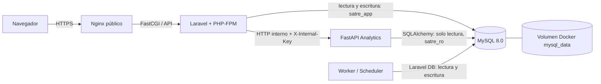

# MySQL en SATRE: arquitectura, arranque y migración a un host

## Resumen

MySQL es la base relacional compartida del sistema. Laravel es el único componente que escribe datos de negocio; el servicio Python de analítica lee un subconjunto de tablas con un usuario separado de solo lectura. El navegador no se conecta a MySQL ni al servicio Python: el tráfico público entra por Nginx y llega a Laravel.

## Arquitectura actual con Docker Compose

- El servicio `mysql` usa la imagen `mysql:8.0`, `utf8mb4` y la collation `utf8mb4_unicode_ci`. Compose le entrega `MYSQL_DATABASE`, `MYSQL_USER`, `MYSQL_PASSWORD` y `MYSQL_ROOT_PASSWORD` desde la configuración del host.
- El puerto se publica como `127.0.0.1:3306:3306`: solo es accesible desde el propio host Docker, no directamente desde Internet. Los contenedores se comunican por la red privada de Compose usando el nombre DNS `mysql` y el puerto `3306`.
- El volumen nombrado `mysql_data` se monta en `/var/lib/mysql`; ahí persisten los datos aunque se recreen los contenedores. El ciclo de vida de los contenedores no es el ciclo de vida de la base de datos. No ejecutar `docker compose down -v` si se deben conservar esos datos: `-v` elimina también el volumen.
- Nginx conecta redes `public` e `internal`; MySQL y Python solo se conectan a `internal`. PHP-FPM, worker y scheduler también se conectan a la red interna.
- El healthcheck de MySQL comprueba que el servidor responda a `mysqladmin ping`. No comprueba que las migraciones de Laravel hayan creado todas las tablas.

## Qué ocurre al arrancar los servicios

1. En la primera inicialización de un volumen de datos vacío, la imagen oficial de MySQL crea la base indicada por `MYSQL_DATABASE` y el usuario de aplicación configurado. También ejecuta los scripts montados desde `deploy/mysql/init`.
2. El script `01-grant-satre-ro.sh` crea/actualiza `satre_ro` y concede `SELECT` sobre `attendances`, `grades`, `incidents`, `residential_presences`, `students`, `enrollments`, `courses`, `classrooms` y `academic_periods`. Los scripts de inicialización de la imagen se ejecutan como parte de la inicialización de datos, no en cada reinicio normal del contenedor. Si se agregan o cambian grants después de que el volumen ya fue inicializado, hay que aplicarlos explícitamente en MySQL.
3. PHP-FPM espera a que el healthcheck de MySQL esté sano. El entrypoint prepara directorios de Laravel e instala Composer si no encuentra `vendor/autoload.php`. Ejecuta `php artisan migrate --force` únicamente cuando `AUTO_MIGRATE=true`; en Compose ese valor es `false` por defecto. Worker y scheduler también mantienen `AUTO_MIGRATE=false`.
4. Por tanto, en la configuración por defecto el arranque de Compose no garantiza que el esquema exista: las migraciones deben ejecutarse como paso controlado de despliegue. Laravel registra cuáles ya ejecutó en la tabla `migrations`. Los seeders tampoco se ejecutan automáticamente por este Compose.
5. Analytics espera a que MySQL responda y conecta como `satre_ro`. Usa `DB_HOST`, `DB_PORT`, `DB_DATABASE`, `DB_USERNAME` y `DB_PASSWORD`. Si no puede conectar a MySQL, el código actual puede caer a SQLite local; no conviene interpretar que el servicio está leyendo MySQL solo porque el contenedor está en ejecución. Revisar logs y confirmar el origen de datos tras el despliegue.

**Orden de inicialización a validar:** el script de init aplica grants tabla por tabla, pero las tablas se crean con las migraciones Laravel, y estas no se ejecutan automáticamente por defecto. En una instalación vacía, probar el primer arranque completo y asegurar que `satre_ro` tenga los permisos después de crear el esquema. Para una base externa, planificar explícitamente la secuencia: crear DB/usuarios, ejecutar migraciones, aplicar y verificar grants; no depender del init script del contenedor MySQL.

## Esquema y responsabilidades

- El esquema es propiedad de las migraciones versionadas de `satre-backend/database/migrations`; no se importa automáticamente desde el directorio de init de MySQL. Incluye tablas de Laravel (usuarios, cache/colas y tokens) y entidades del dominio académico/operativo (periodos, aulas, cursos, estudiantes, matrículas, asistencia, notas, incidencias, residencia), además de alertas, riesgos, auditoría y analítica/tutoría.
- Laravel opera como la aplicación transaccional con `satre_app`: crea y actualiza datos usando las reglas del dominio.
- Analytics consulta MySQL con SQLAlchemy y parámetros enlazados, y fuerza sesiones de solo lectura además del `GRANT SELECT`. Su usuario no debe convertirse en usuario administrador ni tener permisos de escritura.
- La cuenta root es solo de administración/operación; no debe configurarse como cuenta de Laravel o Analytics.

## Migrar MySQL a un servidor administrado o a otro host

### Cambios de conectividad y configuración

- Provisionar MySQL compatible, preferiblemente MySQL 8, con base de datos `satre_coar` (o el valor acordado), `utf8mb4` y `utf8mb4_unicode_ci`.
- Cambiar en las variables de Compose `DB_HOST` de Laravel y Analytics, actualmente fijado como `mysql`, por el hostname privado/DNS del servidor de base de datos. Mantener el puerto `3306` salvo que el proveedor indique otro. En el Compose actual conviene parametrizar ese host en lugar de dejar `DB_HOST: mysql` fijo.
- Configurar firewall/lista de acceso para permitir conexiones solo desde los hosts o redes privadas de PHP-FPM, worker, scheduler y Analytics. No abrir MySQL a todo Internet.
- Crear credenciales separadas: `satre_app` con permisos requeridos por Laravel sobre esa base y `satre_ro` con `SELECT` solamente sobre las tablas consultadas por Analytics. Restringir el origen de cada usuario en vez de usar `'%'` cuando el proveedor lo permita.
- Si el proveedor requiere TLS, configurar y comprobar el certificado CA en ambos clientes. Laravel ya contempla `MYSQL_ATTR_SSL_CA` en `satre-backend/config/database.php`; la creación actual del engine MySQL de Analytics no muestra una configuración TLS explícita, así que debe verificarse y añadirse si el host la exige.
- Al sacar MySQL de Compose, retirar el servicio `mysql`, el montaje del volumen local y las dependencias `depends_on: mysql`; actualizar healthchecks y orden de despliegue. No cambiar la URL interna de Laravel a Analytics (`http://python:8001`): es una conexión de servicio distinta.

### Datos y corte

1. Hacer backup consistente del origen, copiarlo al destino y restaurarlo; el repositorio incluye `deploy/scripts/backup-mysql.sh`, que genera dumps comprimidos con `mysqldump` y permite probar su restauración.
2. Confirmar conteo de tablas y registros, charset/collation, índices, claves foráneas, usuarios/grants y una prueba de conexión desde cada contenedor antes del corte.
3. Apuntar Laravel y Analytics al nuevo host. Ejecutar migraciones de Laravel una sola vez y de forma controlada durante el despliegue (por ejemplo, un job temporal con `php artisan migrate --force`), no simultáneamente desde varios réplicas.
4. Verificar acceso transaccional de Laravel, lectura de Analytics, colas, tareas programadas y logs. Mantener el origen y un backup recuperable hasta completar la validación y el periodo de reversa.

## Variables de entorno involucradas

El archivo `.env` de Compose se usa para interpolar las variables `${...}`; no se copia automáticamente a las imágenes. Debe existir en el host del despliegue, tener permisos restrictivos y no versionarse. Variables relevantes: `MYSQL_DATABASE`, `MYSQL_USER`, `MYSQL_PASSWORD`, `MYSQL_ROOT_PASSWORD`, `SATRE_RO_PASSWORD`, `APP_KEY`, `APP_ENV`, `APP_DEBUG`, `DB_HOST`/`DB_PORT`/`DB_DATABASE`/`DB_USERNAME`/`DB_PASSWORD` y `INTERNAL_KEY` (o `X_INTERNAL_KEY`). `APP_DEBUG` debe ser `false` en producción.

## Archivos de referencia

- `docker-compose.yml`: servicios, redes, puertos, variables, healthchecks y volumen.
- `deploy/mysql/init/01-grant-satre-ro.sh`: usuario analítico y grants.
- `deploy/php/entrypoint.sh`: inicialización del runtime y ejecución opcional de migraciones.
- `satre-backend/config/database.php`: conexión MySQL de Laravel y opción CA para TLS.
- `satre-backend/database/migrations/`: definición/versionado del esquema.
- `satre-analytics/app/core/config.py` y `satre-analytics/app/db.py`: conexión MySQL de Analytics, parámetros del pool, modo read-only y fallback SQLite.
- `deploy/scripts/backup-mysql.sh`: respaldo, rotación y prueba de restauración.
