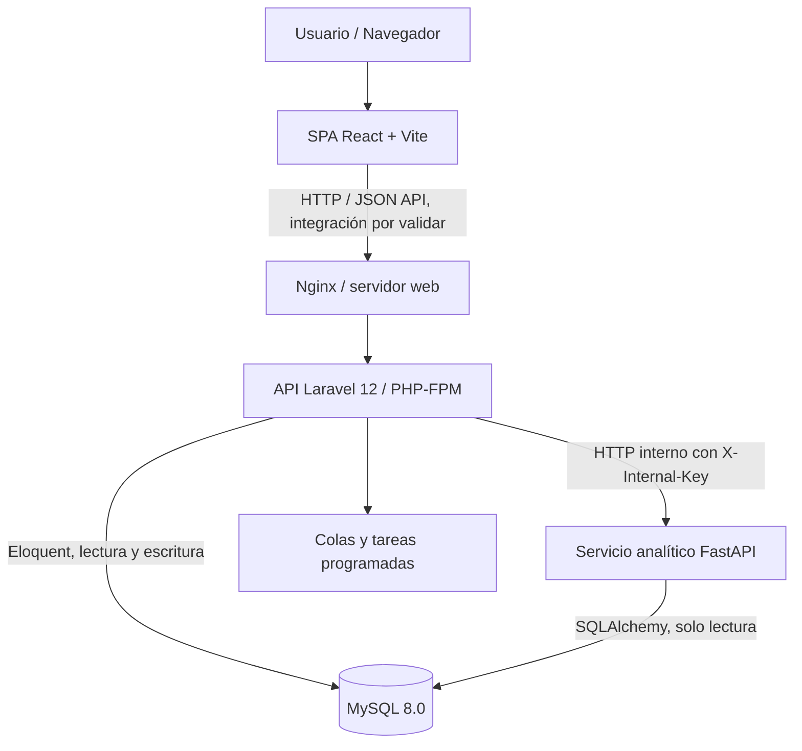
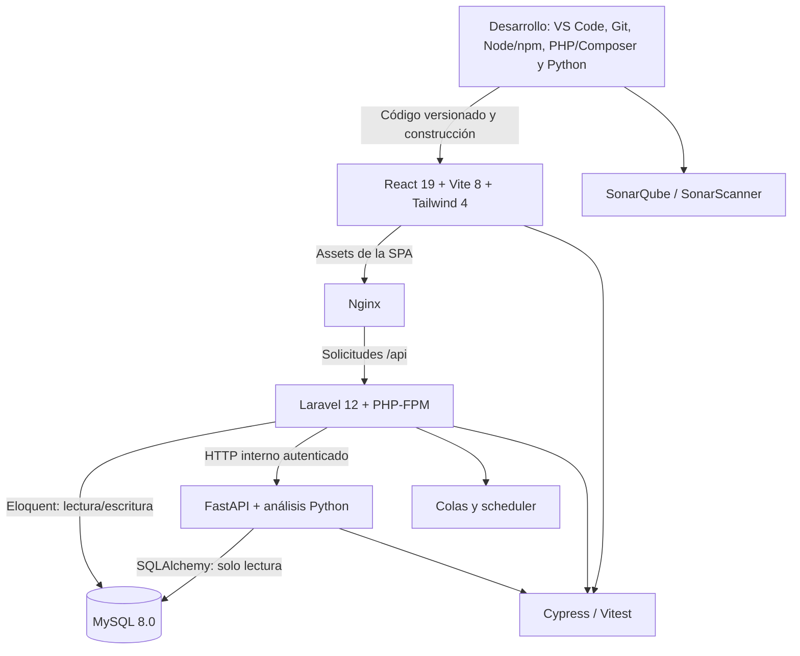

# INFORME TÉCNICO INDIVIDUAL: ARQUITECTURA, PRUEBAS Y CALIDAD DE SOFTWARE

**Universidad:** Universidad Continental  
**Asignatura:** Pruebas y Calidad de Software  
**Estudiante:** Miguel Angel Meza Matias  
**Docente:** Dr. Maglioni Arana Caparachin  
**Fecha:** 9 de noviembre de 2026  
**Proyecto:** Diseño e implementación de un sistema web con inteligencia artificial para la prevención del deterioro del rendimiento académico en estudiantes del COAR Junín  

---

## 1. PORTADA
- **Título del Informe:** Informe Técnico Individual de Arquitectura, Automatización de Pruebas y Análisis de Calidad de Software.
- **Datos Académicos:** Carrera y semestre no especificados; modalidad individual.

---

## 2. DESCRIPCIÓN GENERAL DEL PROYECTO

### 2.1. Problema Identificado
La necesidad que aborda el proyecto es detectar oportunamente señales de deterioro del rendimiento académico en estudiantes del COAR Junín. Sin un seguimiento y análisis oportunos, estas señales podrían identificarse tarde y limitar la posibilidad de brindar acompañamiento preventivo. Esta descripción se basa en el propósito indicado en el título del proyecto; los antecedentes institucionales específicos están pendientes de documentar.

### 2.2. Objetivo del Software
Diseñar e implementar un sistema web que utilice inteligencia artificial para analizar información relacionada con el desempeño académico, identificar indicios de posible deterioro y facilitar alertas o información de apoyo para orientar acciones preventivas en beneficio de los estudiantes del COAR Junín. El alcance concreto de los análisis y las alertas debe confirmarse con los requisitos funcionales del sistema.

### 2.3. Módulos Principales y Usuarios Beneficiarios
- **Módulos Principales:**
  1. **Gestión de usuarios y estudiantes:** administración de cuentas y perfiles de acceso.
  2. **Seguimiento del rendimiento académico:** consulta y organización de información académica relevante para el análisis.
  3. **Análisis inteligente y alertas tempranas:** identificación de señales de riesgo de deterioro del rendimiento para apoyar la intervención preventiva.
  4. **Reportes y seguimiento:** presentación de resultados y evolución académica para apoyar la toma de decisiones.
- **Usuarios Beneficiarios y Roles:** Administrador del sistema (gestiona usuarios y configuración); docentes o tutores (consultan indicadores y dan seguimiento); estudiantes (beneficiarios del acompañamiento y, si está contemplado, consultan su progreso). Estos módulos y roles son una propuesta preliminar inferida del título del proyecto y deben validarse contra el sistema y sus requisitos reales.

---

## 3. ARQUITECTURA DE SOFTWARE

### 3.1. Identificación de la Arquitectura
- **Tipo de Arquitectura:** Cliente-servidor, modular y desacoplada: una SPA en React, una API REST en Laravel y un servicio analítico interno en Python/FastAPI. Laravel actúa como punto de acceso a los datos y como único cliente del servicio analítico.
- **Capas del Sistema:**
  - **Capa de Presentación (Frontend):** SPA desarrollada con React y Vite; presenta vistas según los perfiles (administración, docencia/tutoría, monitoría, estudiante y apoderado) y consume las rutas de la API. El README del frontend indica que actualmente puede ejecutarse de forma independiente con datos simulados; por ello, la integración completa con el backend debe considerarse pendiente de validación en el entorno ejecutable.
  - **Capa de Lógica de Negocio (Backend):** API REST de Laravel 12 y PHP 8.2 o superior. Gestiona autenticación con Sanctum, autorización por roles, reglas del dominio académico, solicitudes HTTP y procesamiento en segundo plano mediante colas y tareas programadas. El servicio analítico separado usa FastAPI para calcular indicadores y predicciones explicables.
  - **Capa de Persistencia (Base de Datos):** MySQL 8.0 para persistir la información. Laravel realiza las operaciones transaccionales; el servicio Python consulta las tablas analíticas con un usuario de solo lectura y SQLAlchemy.
- **Comunicación Interna:** La navegación ocurre en el cliente mediante rutas de React. La SPA se comunica con Laravel mediante solicitudes HTTP/JSON a la API; Laravel se comunica con FastAPI por una interfaz HTTP interna autenticada con `X-Internal-Key`. Python no es accesible directamente desde el navegador y consulta MySQL con permisos de solo lectura. La integración SPA–API debe verificarse en la versión ejecutable, pues el README del frontend registra el uso actual de datos simulados.

### 3.2. Diagrama de Arquitectura de Software


### 3.3. Integración de APIs o Servicios Externos
No se documenta una integración con APIs de terceros para el alcance analítico descrito. El procesamiento se plantea dentro de la infraestructura del sistema: Laravel consume el servicio FastAPI mediante una API interna protegida, y este servicio lee la información necesaria desde MySQL con privilegios de solo lectura. Sanctum es una biblioteca de autenticación del backend, no una API externa.

| API o Servicio | Funcionalidad | Información Intercambiada | Justificación Técnica |
| :--- | :--- | :--- | :--- |
| No se registra una API externa | No aplica | No se intercambian datos con un proveedor externo según la documentación revisada | El análisis se realiza en el servicio FastAPI interno; Laravel controla el acceso al backend y a la base de datos. |

---

## 4. ARQUITECTURA TECNOLÓGICA

### 4.1. Identificación de Tecnologías
| Componente | Tecnología Utilizada | Propósito / Justificación |
| :--- | :--- | :--- |
| **Frontend** | React 19, React Router 7, Vite 8 y Tailwind CSS 4 | Construcción de la SPA y sus vistas por rol; el frontend documenta ejecución independiente con datos simulados. |
| **Backend** | PHP 8.2 o superior y Laravel 12 | API REST, autenticación, autorización, reglas del dominio y procesos asíncronos. |
| **Base de Datos** | MySQL 8.0 (configuración de Docker Compose) | Persistencia relacional; Laravel usa credenciales de aplicación y Python cuenta con acceso de solo lectura para análisis. |
| **Framework / Libs** | Laravel Sanctum 4; FastAPI; SQLAlchemy 2; Pandas, NumPy, SciPy y scikit-learn | Autenticación API y servicio interno de análisis de datos/riesgo. |
| **Entorno de Desarrollo** | Visual Studio Code; Node.js/npm, PHP/Composer y Python/venv | Edición y ejecución de los componentes. Las versiones de VS Code y Node.js no están especificadas en la documentación revisada. |
| **Control de Versiones** | Git | Historial y control de cambios del repositorio. No se confirmó un proveedor remoto de alojamiento. |
| **Servidor / Infraestructura**| Docker Compose opcional, Nginx, PHP-FPM, MySQL y contenedor Python; Vite, Artisan y Uvicorn para desarrollo local | Ejecución modular de frontend, API, persistencia, analítica y trabajadores. |
| **Automatización de Pruebas**| Cypress 16, Vitest 5, PHPUnit 11 y pytest | Pruebas E2E de interfaz y pruebas unitarias/de integración por componente, según dependencias y proyectos disponibles. |
| **Análisis de Calidad** | SonarQube / SonarScanner (configuración presente; versión no consignada) | Evaluación estática de la calidad del código fuente. |

### 4.2. Diagrama de Arquitectura Tecnológica


### 4.3. Entorno de Trabajo y Despliegue
- **Entorno de Desarrollo:** Visual Studio Code y Git; Node.js/npm para la SPA, PHP/Composer para Laravel y Python con un entorno virtual para FastAPI. Para ejecución local se documentan Vite en `http://localhost:5173`, Laravel mediante Artisan y el servicio analítico Uvicorn en `127.0.0.1:8001`. Las versiones instaladas del IDE y Node.js no están consignadas. La documentación del frontend advierte que este componente puede funcionar con datos simulados y sin conexión efectiva al backend.
- **Procedimiento de Ejecución:** Instalar dependencias del frontend con `npm install` y ejecutarlo con `npm run dev`; instalar dependencias del backend con `composer install`, configurar `.env`, generar la clave de Laravel y aplicar migraciones; iniciar la API con `php artisan serve`. Para analítica, crear y activar un entorno virtual en `satre-analytics`, instalar `requirements-dev.txt`, configurar las variables de entorno y ejecutar `uvicorn app.main:app --host 127.0.0.1 --port 8001 --env-file .env --no-access-log`. Para despliegue integrado, `docker-compose.yml` define Nginx, PHP-FPM, MySQL, servicio Python, worker y scheduler; los secretos deben configurarse en `.env` y no incluirse en el repositorio.
- **Estrategia de Despliegue/Actualización:** El repositorio incluye una configuración de despliegue con Docker Compose, con Nginx como entrada pública y MySQL/servicio Python en la red interna. Como flujo recomendado, versionar los cambios con Git, ejecutar las pruebas de cada componente y construir la SPA antes de actualizar los contenedores; respaldar la base de datos y aplicar las migraciones de forma controlada. No se encontró evidencia de un proceso CI/CD de despliegue automatizado, por lo que la actualización se describe como procedimiento operativo y no como automatización ya verificada.

---

## 5. INTEGRACIÓN Y AUTOMATIZACIÓN DE PRUEBAS CON CYPRESS

### 5.1. Configuración y alcance
- **URL base solicitada para este informe:** `http://localhost/mi_proyecto`.
- **Configuración observada:** el proyecto frontend declara Cypress `^16.0.0`, scripts `cypress:open`/`cypress:run`, especificaciones `cypress/e2e/**/*.cy.{js,jsx}` y `baseUrl: http://localhost:5173` en `cypress.config.js`. La URL informada y la configuración actual no coinciden; debe confirmarse el servidor objetivo o sobrescribirse `baseUrl` antes de ejecutar estos casos.
- **Estructura existente:** `coar-alerta-frontend/cypress/e2e/` contiene pruebas para navegación y roles; `cypress/support/e2e.js` carga los comandos compartidos.
- **Alcance de la evidencia:** se encontraron specs y configuración Cypress, pero no un reporte de ejecución de estos cinco IDs. Los specs actuales usan respuestas HTTP simuladas con `cy.intercept`; por tanto, validan flujos de UI contra mocks y no demuestran por sí solos integración real con Laravel.
- **Credenciales:** los ejemplos usan usuarios ficticios de prueba y respuestas interceptadas; no se deben documentar credenciales reales.

### 5.2. Diseño de escenarios automatizados

- **CY-001:** acceso y autenticación de usuario (login exitoso).
- **CY-002:** registro de una nueva incidencia.
- **CY-003:** edición y actualización de una incidencia existente.
- **CY-004:** validación de campos obligatorios.
- **CY-005:** navegación entre módulos del panel.

### 5.3. Implementación de las pruebas
#### CY-001 — Acceso y autenticación de usuario (login exitoso)
| Campo | Descripción |
| :--- | :--- |
| **Identificador** | CY-001 |
| **Funcionalidad** | Inicio de sesión y acceso según rol de docente. |
| **Objetivo** | Verificar el envío del formulario de login y el ingreso al panel del tutor/docente. |
| **Datos de prueba** | Usuario docente ficticio; la respuesta de login y las consultas posteriores se simulan con `cy.intercept`. |
| **Procedimiento** | Abrir `/login`, completar los controles `data-cy="email"` y `data-cy="password"`, enviar y validar `/tutor`. |
| **Resultado esperado** | La aplicación navega al panel del tutor y presenta su dashboard. |
| **Resultado obtenido** | No documentado: se reporta la prueba, pero no se aportó su salida o estado individual. |
| **Estado** | RESULTADO NO DOCUMENTADO |

Fragmento `.cy.js` propuesto:
```javascript
describe('CY-001: acceso y autenticación', () => {
  it('permite acceder con credenciales válidas', () => {
    const user = { id: 2, name: 'Usuario E2E', email: 'docente.e2e@coar.edu.pe', role: { slug: 'teacher', name: 'Docente' }, must_change_password: false };
    cy.intercept('GET', '**/api/health', { status: 'ok' });
    cy.intercept('POST', '**/api/auth/login', { token: 'test-token', expires_at: null, user, must_change_password: false });
    cy.intercept('GET', '**/api/auth/me', { user });
    cy.intercept('GET', '**/api/courses', { data: [] }).as('courses');
    cy.visit('/login');
    cy.get('[data-cy="email"]').type(user.email);
    cy.get('[data-cy="password"]').type('clave-e2e-ficticia', { log: false });
    cy.get('[data-cy="submit-login"]').click();
    cy.wait('@courses');
    cy.location('pathname').should('eq', '/tutor');
    cy.get('[data-cy="dashboard-tutor"]').should('be.visible');
  });
});
```

#### CY-002 — Registro de un nuevo registro en el sistema
| Campo | Descripción |
| :--- | :--- |
| **Identificador** | CY-002 |
| **Funcionalidad** | Alta de incidencia de residencia. |
| **Objetivo** | Comprobar el guardado de un registro nuevo con estudiante, categoría, gravedad y descripción válidos. |
| **Datos de prueba** | Estudiante `EST-0003`, categoría `conducta`, gravedad `leve` y descripción única de prueba. |
| **Procedimiento** | Abrir `/residencia/incidencias`, seleccionar “Nueva incidencia”, completar los campos obligatorios y registrar. |
| **Resultado esperado** | Se envía `POST /api/incidents`, se confirma el alta y el registro aparece en la lista. |
| **Resultado obtenido** | No documentado: se reporta la prueba, pero no se aportó su salida o estado individual. |
| **Estado** | RESULTADO NO DOCUMENTADO |

Fragmento `.cy.js` propuesto:
```javascript
describe('CY-002: alta de registro', () => {
  it('registra una incidencia nueva', () => {
    const incident = {
      id: 8, student_id: 3, student_name: 'Estudiante E2E', incident_at: '2026-04-15T10:00:00Z',
      category: 'conducta', severity: 'leve', description: 'Incidencia automatizada E2E', status: 'open',
    };
    let savedIncident = null;
    cy.intercept('GET', '**/api/health', { status: 'ok' });
    cy.intercept('POST', '**/api/auth/login', { token: 'test-token', expires_at: null, user: { id: 4, name: 'Monitor E2E', email: 'monitor.e2e@coar.edu.pe', role: { slug: 'monitor', name: 'Monitor de Residencia' }, must_change_password: false }, must_change_password: false });
    cy.intercept('GET', '**/api/auth/me', { user: { id: 4, name: 'Monitor E2E', email: 'monitor.e2e@coar.edu.pe', role: { slug: 'monitor', name: 'Monitor de Residencia' }, must_change_password: false } });
    cy.intercept('GET', '**/api/residents*', { data: [{ id: 3, student_code: 'EST-0003', name: 'Estudiante E2E', presence: null }] });
    cy.intercept('GET', '**/api/incidents*', (request) => {
      request.reply({
        data: savedIncident ? [savedIncident] : [],
        meta: { current_page: 1, last_page: 1, total: savedIncident ? 1 : 0, from: savedIncident ? 1 : 0, to: savedIncident ? 1 : 0, per_page: 15 },
      });
    });
    cy.intercept('POST', '**/api/incidents', (request) => {
      savedIncident = { ...incident, ...request.body };
      request.reply({ statusCode: 201, body: savedIncident });
    }).as('createIncident');
    cy.visit('/login');
    cy.get('[data-cy="email"]').type('monitor.e2e@coar.edu.pe');
    cy.get('[data-cy="password"]').type('clave-e2e-ficticia', { log: false });
    cy.get('[data-cy="submit-login"]').click();
    cy.visit('/residencia/incidencias');
    cy.get('[data-cy="nueva-incidencia"]').click();
    cy.get('select[name="student_id"]').select('3');
    cy.get('select[name="category"]').select('conducta');
    cy.get('select[name="severity"]').select('leve');
    cy.get('textarea[name="description"]').type(incident.description);
    cy.contains('button', 'Registrar').click();
    cy.wait('@createIncident').its('request.body').should('include', {
      student_id: 3, category: 'conducta', severity: 'leve', description: incident.description,
    });
    cy.get('[data-cy="toast-success"]').should('be.visible');
    cy.contains(incident.description).should('be.visible');
  });
});
```

#### CY-003 — Edición y actualización de un registro existente
| Campo | Descripción |
| :--- | :--- |
| **Identificador** | CY-003 |
| **Funcionalidad** | Edición de incidencia de residencia. |
| **Objetivo** | Verificar que se puede modificar un registro existente y que se conserva su identidad. |
| **Datos de prueba** | Incidencia abierta existente con ID `7`; nueva descripción de prueba. |
| **Procedimiento** | Abrir `/residencia/incidencias`, editar la incidencia, cambiar la descripción y guardar. |
| **Resultado esperado** | Se envía `PUT /api/incidents/7`, aparece confirmación y se muestra la descripción actualizada. |
| **Resultado obtenido** | No documentado: se reporta la prueba, pero no se aportó su salida o estado individual. |
| **Estado** | RESULTADO NO DOCUMENTADO |

Fragmento `.cy.js` propuesto:
```javascript
describe('CY-003: edición y actualización', () => {
  it('edita una incidencia abierta existente', () => {
    const user = { id: 4, name: 'Monitor E2E', email: 'monitor.e2e@coar.edu.pe', role: { slug: 'monitor', name: 'Monitor de Residencia' }, must_change_password: false };
    let incident = {
      id: 7, student_id: 3, student_name: 'Estudiante E2E', incident_at: '2026-04-15T10:00:00Z',
      category: 'conducta', severity: 'leve', description: 'Descripción original', status: 'open',
    };
    const updatedDescription = 'Descripción actualizada por Cypress';
    cy.intercept('GET', '**/api/health', { status: 'ok' });
    cy.intercept('POST', '**/api/auth/login', { token: 'test-token', expires_at: null, user, must_change_password: false });
    cy.intercept('GET', '**/api/auth/me', { user });
    cy.intercept('GET', '**/api/incidents*', (request) => {
      request.reply({ data: [incident], meta: { current_page: 1, last_page: 1, total: 1, from: 1, to: 1, per_page: 15 } });
    }).as('incidents');
    cy.intercept('PUT', '**/api/incidents/7', (request) => {
      incident = { ...incident, ...request.body };
      request.reply({ statusCode: 200, body: incident });
    }).as('updateIncident');
    cy.visit('/login');
    cy.get('[data-cy="email"]').type(user.email);
    cy.get('[data-cy="password"]').type('clave-e2e-ficticia', { log: false });
    cy.get('[data-cy="submit-login"]').click();
    cy.visit('/residencia/incidencias');
    cy.wait('@incidents');
    cy.contains('button', 'Editar').click();
    cy.get('textarea[name="description"]').clear().type(updatedDescription);
    cy.contains('button', 'Guardar').click();
    cy.wait('@updateIncident').its('request.body.description').should('eq', updatedDescription);
    cy.get('[data-cy="toast-success"]').should('be.visible');
    cy.contains(updatedDescription).should('be.visible');
  });
});
```

#### CY-004 — Validación de campos obligatorios en formulario
| Campo | Descripción |
| :--- | :--- |
| **Identificador** | CY-004 |
| **Funcionalidad** | Validación de campos requeridos en el alta de incidencia. |
| **Objetivo** | Verificar mensajes para estudiante, categoría, gravedad y descripción cuando se intenta enviar el formulario vacío. |
| **Datos de prueba** | Formulario nuevo sin completar; fecha/hora se inicializa automáticamente. |
| **Procedimiento** | En `/residencia/incidencias`, abrir “Nueva incidencia” y pulsar “Registrar” sin completar los campos. |
| **Resultado esperado** | Se muestran los errores por campo y no se envía la solicitud `POST /api/incidents`. |
| **Resultado obtenido** | No documentado: se reporta la prueba, pero no se aportó su salida o estado individual. |
| **Estado** | RESULTADO NO DOCUMENTADO |

Fragmento `.cy.js` propuesto:
```javascript
describe('CY-004: campos obligatorios', () => {
  it('rechaza el alta vacía y muestra errores por campo', () => {
    const user = { id: 4, name: 'Monitor E2E', email: 'monitor.e2e@coar.edu.pe', role: { slug: 'monitor', name: 'Monitor de Residencia' }, must_change_password: false };
    cy.intercept('GET', '**/api/health', { status: 'ok' });
    cy.intercept('POST', '**/api/auth/login', { token: 'test-token', expires_at: null, user, must_change_password: false });
    cy.intercept('GET', '**/api/auth/me', { user });
    cy.intercept('GET', '**/api/incidents*', { data: [], meta: { current_page: 1, last_page: 1, total: 0, from: 0, to: 0, per_page: 15 } });
    cy.intercept('GET', '**/api/residents*', { data: [{ id: 3, student_code: 'EST-0003', name: 'Estudiante E2E' }] });
    cy.intercept('POST', '**/api/incidents').as('createIncident');
    cy.visit('/login');
    cy.get('[data-cy="email"]').type(user.email);
    cy.get('[data-cy="password"]').type('clave-e2e-ficticia', { log: false });
    cy.get('[data-cy="submit-login"]').click();
    cy.visit('/residencia/incidencias');
    cy.get('[data-cy="nueva-incidencia"]').click();
    cy.contains('button', 'Registrar').click();
    cy.contains('Selecciona al estudiante.').should('be.visible');
    cy.contains('Elige la categoría.').should('be.visible');
    cy.contains('Elige la gravedad.').should('be.visible');
    cy.contains('Describe lo ocurrido.').should('be.visible');
    cy.get('@createIncident.all').should('have.length', 0);
  });
});
```

#### CY-005 — Navegación entre módulos
| Campo | Descripción |
| :--- | :--- |
| **Identificador** | CY-005 |
| **Funcionalidad** | Navegación entre módulos del panel docente (alternativa no destructiva a eliminación). |
| **Objetivo** | Verificar el acceso a Riesgo del aula, Asistencia y Calificaciones desde el menú lateral. |
| **Datos de prueba** | Usuario docente ficticio; endpoints necesarios interceptados con respuestas de prueba. |
| **Procedimiento** | Iniciar sesión y seleccionar sucesivamente Asistencia y Calificaciones desde el menú lateral. |
| **Resultado esperado** | Cada enlace cambia la ruta al módulo indicado y queda marcado como página activa. |
| **Resultado obtenido** | No documentado: se reporta la prueba, pero no se aportó su salida o estado individual. |
| **Estado** | RESULTADO NO DOCUMENTADO |

Fragmento `.cy.js` propuesto:
```javascript
describe('CY-005: navegación entre módulos', () => {
  it('navega entre riesgo, asistencia y calificaciones', () => {
    const user = { id: 2, name: 'Usuario E2E', email: 'docente.e2e@coar.edu.pe', role: { slug: 'teacher', name: 'Docente' }, must_change_password: false };
    const meta = { current_page: 1, last_page: 1, total: 0, from: 0, to: 0, per_page: 15 };
    cy.intercept('GET', '**/api/health', { status: 'ok' });
    cy.intercept('POST', '**/api/auth/login', { token: 'test-token', expires_at: null, user, must_change_password: false });
    cy.intercept('GET', '**/api/auth/me', { user });
    cy.intercept('GET', '**/api/courses', { data: [] }).as('courses');
    cy.intercept('GET', '**/api/attendances/session*', { data: { course_id: 5, students: [] } });
    cy.intercept('GET', '**/api/grades*', { data: [], meta });
    cy.visit('/login');
    cy.get('[data-cy="email"]').type(user.email);
    cy.get('[data-cy="password"]').type('clave-e2e-ficticia', { log: false });
    cy.get('[data-cy="submit-login"]').click();
    cy.wait('@courses');
    cy.location('pathname').should('eq', '/tutor');
    cy.get('nav a[aria-current="page"]').should('contain.text', 'Riesgo del aula');
    cy.contains('nav a', 'Asistencia').click();
    cy.location('pathname').should('eq', '/tutor/asistencia');
    cy.get('nav a[aria-current="page"]').should('contain.text', 'Asistencia');
    cy.contains('nav a', 'Calificaciones').click();
    cy.location('pathname').should('eq', '/tutor/notas');
    cy.get('nav a[aria-current="page"]').should('contain.text', 'Calificaciones');
  });
});
```

> **Nota de ejecución:** los escenarios usan selectores y rutas presentes en el frontend. Las llamadas API se interceptan, así que los ejemplos no acreditan persistencia real ni integración backend. La ruta base reportada debe conciliarse con la `baseUrl` configurada antes de correrlos.

### 5.4. Reporte consolidado de resultados

El solicitante indica que se probaron los cinco escenarios. No se adjuntó un reporte de Cypress ni una salida por caso; por ello, el total de escenarios reportados es 5, pero no es posible confirmar cuántos aprobaron o fallaron ni calcular una tasa real.

| Métrica | Resultado verificable |
| :--- | :--- |
| **Pruebas diseñadas** | 5 |
| **Escenarios reportados como probados** | 5 |
| **Pruebas ejecutadas con evidencia verificable** | No disponible |
| **Aprobadas confirmadas** | No disponible |
| **Fallidas confirmadas** | No disponible |
| **Porcentaje de aprobación** | N/D — calcular como aprobadas / ejecutadas × 100 cuando exista una ejecución válida. |

| ID | Escenario | Resultado | Evidencia |
| :--- | :--- | :--- | :--- |
| CY-001 | Login exitoso | Reportado, sin resultado documentado | Sin salida individual aportada. |
| CY-002 | Registro nuevo | Reportado, sin resultado documentado | Sin salida individual aportada. |
| CY-003 | Edición de registro | Reportado, sin resultado documentado | Sin salida individual aportada. |
| CY-004 | Campos obligatorios | Reportado, sin resultado documentado | Sin salida individual aportada. |
| CY-005 | Navegación entre módulos | Reportado, sin resultado documentado | Sin salida individual aportada. |

### 5.5. Análisis de errores, fallos y acciones

- **Fallos funcionales detectados:** no se puede confirmar ni descartar fallos sin el detalle de ejecución. La ausencia de fallos documentados no equivale a que los cinco casos hayan aprobado.
- **Bloqueo de evaluación:** faltan los resultados del Cypress Test Runner (total ejecutado, aprobados, fallidos y detalle de errores). La tasa de aprobación queda N/D hasta completar esa ejecución.
- **Riesgo de entorno:** la URL solicitada (`http://localhost/mi_proyecto`) no coincide con la `baseUrl` configurada (`http://localhost:5173`). Si se ejecuta sin resolver esta diferencia, Cypress puede visitar otra instancia o no alcanzar la SPA.
- **Alcance de integración:** los ejemplos interceptan respuestas de API; un PASS de estos casos solo demostraría el flujo de interfaz contra mocks, no persistencia ni integración real con Laravel.
- **Acción recomendada:** confirmar el host/base path correcto, ejecutar los cinco casos contra esa instancia y conservar el reporte/log del Test Runner. Si algún caso falla, documentar ID, paso, resultado esperado/obtenido, evidencia, severidad y resultado de la re-prueba.
- **Criterio para consolidar:** informar como aprobados o fallidos solo casos efectivamente ejecutados. Los casos omitidos o bloqueados se contabilizan aparte y no se incluyen en el denominador de aprobación.

---

## 6. INTEGRACIÓN DE SONARQUBE PARA EL ANÁLISIS DE CALIDAD DEL SOFTWARE

El monorepo SATRE (Laravel 12 + React 19 + FastAPI + infraestructura) se analiza como **un único proyecto Sonar** (`uc-group4612142_satre`) para obtener una línea base integrada de las tres tecnologías. La ejecución de referencia se realizó con **SonarQube Community Build 26.10.0** (contenedor local en `http://localhost:9000`) y **SonarScanner CLI 8.2.0** sobre Java 21. El log `sonar-run.log` registra `EXECUTION SUCCESS`, 457 archivos indexados y 4 min 52 s de análisis. Las cifras de esta sección se consultaron por API el **10/11/2026** y se conservan como evidencia en `docs/sonar/evidencias/` (`medidas-overall-2026-11-10.json`, `quality-gate-2026-11-10.json`, `issues-2026-11-10.json`).

### 6.1. Configuración de SonarQube

**Entorno de análisis**

| Elemento | Valor utilizado |
| :--- | :--- |
| Servidor | SonarQube Community Build 26.10.0 (contenedor Docker `sonarqube`, volúmenes persistentes `sonarqube_data`, `sonarqube_logs`, `sonarqube_extensions`) |
| URL del servidor | `http://localhost:9000` (publicado en `127.0.0.1`) |
| Scanner | SonarScanner CLI 8.2.0, Java 21 (Eclipse Adoptium) |
| Clave del proyecto | `uc-group4612142_satre` — un solo proyecto para los tres stacks |
| Alcance | `satre-backend/app`, `coar-alerta-frontend/src`, `satre-analytics/app`, `deploy`, `.github` |
| Archivos indexados | 457 (PHP 278, Python 44, JS/JSX 106, Docker 2) |
| Autenticación | Token de análisis inyectado por variable de entorno (`SONAR_TOKEN`), nunca en el archivo |
| Fecha del análisis | 23/10/2026 (`EXECUTION SUCCESS`); consulta de métricas: 10/11/2026 |

**Parámetros de análisis (`sonar-project.properties`)**

Configuración normalizada, equivalente a la utilizada por el scanner y sin secretos:

```properties
# Identidad del proyecto
sonar.projectKey=uc-group4612142_satre
sonar.projectName=SATRE
sonar.projectVersion=1.0.0
sonar.sourceEncoding=UTF-8

# Servidor (el token NO se escribe aquí: se inyecta por variable de entorno)
sonar.host.url=http://localhost:9000

# Código fuente de los tres stacks + infraestructura
sonar.sources=satre-backend/app,satre-backend/bootstrap/app.php,satre-backend/config,satre-backend/database,satre-backend/routes,satre-backend/resources/views,coar-alerta-frontend/src,satre-analytics/app,deploy,.github

# Pruebas
sonar.tests=satre-backend/tests,satre-analytics/tests
sonar.test.inclusions=satre-backend/tests/**/*.php,satre-analytics/tests/**/*.py

# Exclusiones: dependencias, artefactos generados, cachés y reportes
sonar.exclusions=**/vendor/**,**/node_modules/**,**/dist/**,**/build/**,**/coverage/**,**/.venv/**,**/venv/**,**/__pycache__/**,**/.pytest_cache/**,**/storage/**,**/bootstrap/cache/**,**/public/build/**,**/*.min.js,**/*.map,**/package-lock.json,**/composer.lock,**/*.sqlite,**/data/**,**/coverage.xml,**/.coverage,**/.scannerwork/**

# Cobertura de las tres suites (se genera antes del scanner)
sonar.php.coverage.reportPaths=satre-backend/coverage.xml
sonar.javascript.lcov.reportPaths=coar-alerta-frontend/coverage/lcov.info
sonar.python.coverage.reportPaths=satre-analytics/coverage.xml

# Fuera del denominador de cobertura: arranque, configuración, migraciones y tests
sonar.coverage.exclusions=**/*.test.js,**/*.test.jsx,satre-backend/bootstrap/**,satre-backend/config/**,satre-backend/database/**,satre-backend/routes/**,coar-alerta-frontend/src/main.jsx
```

| Propiedad | Función | Justificación en SATRE |
| :--- | :--- | :--- |
| `sonar.projectKey` | Identificador único del proyecto | Conserva la trazabilidad de la línea base anterior |
| `sonar.projectVersion` | Versión analizada | Permite comparar V1.0 con la versión siguiente |
| `sonar.sourceEncoding` | Codificación de lectura | Los fuentes contienen tildes y caracteres en español |
| `sonar.sources` | Código de producción | Cubre los tres stacks y la infraestructura, no solo `app/` |
| `sonar.tests` / `sonar.test.inclusions` | Separar pruebas de producción | PHP y Python tienen carpetas de test dedicadas |
| `sonar.exclusions` | Excluir terceros y generados | `vendor`, `node_modules`, `dist`, cachés y reportes no son código del equipo |
| `sonar.*.coverage.reportPaths` | Importar cobertura | Sonar no genera cobertura: la recibe de PHPUnit, Vitest y pytest |
| `sonar.coverage.exclusions` | Excluir glue code | No se excluye lógica de negocio, solo arranque, configuración y migraciones |

> **Hallazgo de configuración (prioridad P0):** el archivo local `C:\Proyecto\sonar-project.properties` no está versionado, pero contiene un `sonar.token=sqp_...` en texto plano y claves repetidas (`sonar.host.url`, `sonar.sources`, `sonar.exclusions`). Como la última definición gana, la lista de exclusiones final quedó reducida y anula protecciones como `**/vendor/**` y `**/*.test.js`. Antes de repetir el análisis hay que (1) retirar el token del archivo y leerlo de `$env:SONAR_TOKEN`, (2) dejar una sola definición por clave y (3) añadir el archivo a `.gitignore`. Este informe documenta la configuración normalizada, sin secretos.

**Generación previa de la cobertura**

| Stack | Herramienta | Comando | Reporte importado |
| :--- | :--- | :--- | :--- |
| Laravel / PHP | PHPUnit + Xdebug o PCOV | `php artisan test --coverage-clover=coverage.xml` | `satre-backend/coverage.xml` (Clover) |
| React / JS | Vitest + V8 | `npm run test -- --coverage` | `coar-alerta-frontend/coverage/lcov.info` |
| FastAPI / Python | pytest-cov | `python -m pytest --cov=app --cov-report=xml:coverage.xml` | `satre-analytics/coverage.xml` (Cobertura) |

**Ejecución del análisis**

```powershell
cd C:\Proyecto
$env:SONAR_TOKEN = "sqp_..."   # variable de sesión; nunca en el archivo
sonar-scanner -Dsonar.host.url=http://localhost:9000 -Dsonar.projectVersion=1.0.0
```

En integración continua se añade `sonar.qualitygate.wait=true` para que el pipeline falle cuando el Quality Gate no se cumple, en lugar de publicar un resultado que nadie revisa.

### 6.2. Análisis de Resultados y Métricas

**Tabla 6.1 — Métricas globales (Overall Code)**

| Métrica | Resultado Obtenido | Referencia | Interpretación Técnica |
| :--- | :--- | :--- | :--- |
| **Quality Gate** | **Passed** | 3 condiciones | Se cumplen las tres condiciones sobre código nuevo: cobertura 83,9 % (≥ 80 %), duplicación 0,90 % (≤ 3 %) y 0 issues nuevos (≤ 0). |
| **Bugs** | **0 abiertos** (12 históricos cerrados) | 0 | No hay defectos de fiabilidad pendientes; los 12 bugs del frontend (11 promesas sin manejar y una comparación de flotantes con igualdad exacta) fueron corregidos y verificados por el servidor. |
| **Vulnerabilities** | **0** | 0 | No hay patrones de seguridad confirmados. El token expuesto en la configuración local es un riesgo operativo, no un hallazgo del analizador. |
| **Code Smells** | **0 abiertos** (19 históricos cerrados) | 0 | Sin deuda de mantenibilidad abierta; los 19 hallazgos (17 regex con retroceso, una IP hardcodeada y un objeto literal como valor por defecto) quedaron resueltos. |
| **Coverage** | **86,7 %** | ≥ 80 % | Cobertura global sobre código ejecutable; líneas 90,3 % y ramas 73,3 %. El punto débil son las ramas, no las líneas. |
| **Duplicated Lines** | **1,1 %** (321 líneas, 19 bloques) | ≤ 3 % | Duplicación baja y concentrada en el backend (1,5 %), dentro del umbral aceptado. |
| Security Hotspots | 0 | 0 pendientes | No hay puntos de revisión de seguridad sin evaluar. |
| Ratings | A / A / A (1,0) | A | Security, Reliability y Maintainability en el nivel máximo. |
| ncloc | 23.150 | — | PHP 11.449, JavaScript 8.611, Python 3.007, Docker 46, CSS 37. |
| Complejidad cognitiva | 2.279 | — | Frontend 977, backend 706, analítica 596: es la deuda estructural real que queda. |

**Tabla 6.2 — Condiciones del Quality Gate**

| Condición | Umbral | Valor obtenido | Estado |
| :--- | :--- | :--- | :--- |
| Cobertura en código nuevo (`new_coverage`) | < 80 % | 83,9 % | OK |
| Duplicación en código nuevo (`new_duplicated_lines_density`) | > 3 % | 0,898 % | OK |
| Issues nuevos (`new_violations`) | > 0 | 0 | OK |

Periodo evaluado: `PREVIOUS_VERSION` (23/10/2026), de modo que el umbral se aplica a lo agregado desde la versión anterior y no a la deuda histórica.

**Tabla 6.3 — Métricas por componente**

| Componente | ncloc | Cobertura | Cobertura de líneas | Cobertura de ramas | Duplicación | Complejidad cognitiva |
| :--- | ---: | ---: | ---: | ---: | ---: | ---: |
| `satre-backend` (Laravel) | 11.449 | 90,9 % | 90,9 % | n/d | 1,5 % | 706 |
| `coar-alerta-frontend/src` (React) | 8.648 | 78,1 % | 82,5 % | 73,3 % | 0,9 % | 977 |
| `satre-analytics/app` (FastAPI) | 3.007 | 100,0 % | 100,0 % | n/d | 0,0 % | 596 |
| `deploy` (infraestructura) | 46 | n/d | n/d | n/d | 0,0 % | n/d |

**Tabla 6.4 — Hallazgos históricos cerrados (31 issues, resolución FIXED)**

| Regla | Cantidad | Tipo | Severidad | Qué detectaba |
| :--- | ---: | :--- | :--- | :--- |
| `javascript:S9383` | 11 | Bug | Major | Promesas sin `await`, `.catch()` ni `void` en componentes y páginas React. |
| `python:S8786` | 10 | Code Smell | Major | Expresiones regulares con retroceso superlineal en `create_protocol.py`. |
| `javascript:S8786` | 7 | Code Smell | Major | Regex ineficientes en `client.js`, `sanitizeMermaid.js` y `createProtocol.js`. |
| `javascript:S1244` | 1 | Bug | Major | Comparación de flotantes con igualdad exacta en `mineduScale.test.js`. |
| `javascript:S7737` | 1 | Code Smell | Minor | Objeto literal como valor por defecto de un parámetro. |
| `javascript:S1313` | 1 | Code Smell | Minor | Dirección IP hardcodeada en una prueba. |
| **Total** | **31** | 12 bugs + 19 code smells | 29 Major + 2 Minor | — |

### 6.3. Interpretación de Resultados

- **¿Qué resultado obtuvo en el Quality Gate?:** **Passed**. Las tres condiciones se cumplen con margen: la cobertura de código nuevo (83,9 %) supera el umbral de 80 %, la duplicación nueva (0,898 %) está muy por debajo del 3 % y no se introdujeron issues nuevos. El proyecto es apto para integrarse, aunque el margen de cobertura es estrecho: una reducción de 4 puntos lo haría fallar.
- **¿Qué problemas fueron identificados?:** la instancia local registró 31 hallazgos, todos ya cerrados: 12 bugs (11 promesas no manejadas en React y 1 comparación de flotantes con igualdad exacta) y 19 code smells, de los cuales 17 corresponden a expresiones regulares con retroceso superlineal. No hay vulnerabilidades ni hotspots pendientes. La deuda restante no aparece como issue, sino como **complejidad cognitiva** (2.279 en total) y **duplicación** (19 bloques).
- **¿Qué componentes presentan mayores observaciones?:** el **frontend** concentra la mayor complejidad cognitiva (977) y la menor cobertura (78,1 %, con 73,3 % de ramas), además del mayor volumen de bugs históricos (S9383). El **backend** tiene la mayor duplicación (1,5 %) y el mayor tamaño (11.449 líneas). La **analítica** es el componente más sano: 100 % de cobertura, 0 % de duplicación y 596 de complejidad.
- **¿Qué vulnerabilidades fueron detectadas?:** **ninguna** en la instancia local. La línea base de referencia de octubre de 2026 (exportación de SonarCloud documentada en `docs/sonar/GUIA_SONARQUBE_SATRE.md`) sí registraba 16 vulnerabilidades, 10 de ellas mayores, concentradas en GitHub Actions, Dockerfiles y configuración de sesión PHP. Esas dos mediciones no son estrictamente comparables porque cambian servidor, perfil de calidad y alcance; deben verificarse en la instancia que se use como evidencia oficial.
- **¿Cuál es el nivel de cobertura alcanzado?:** **86,7 % global** (90,3 % de líneas y 73,3 % de ramas). Por componente: backend 90,9 %, analítica 100 % y frontend 78,1 %. La cobertura del frontend se calcula sobre `src/**/*.{js,jsx}` con `coverage.include` en `vite.config.js`, es decir, sobre el código real y no sobre un subconjunto. El indicador global no debe calcularse promediando los tres porcentajes: cada uno tiene un denominador distinto.
- **Evolución respecto a la línea base:** la exportación de referencia de octubre registraba 229 issues (212 code smells, 16 vulnerabilidades y 1 bug) y 2,6 % de duplicación. La instancia local, tras el ciclo de corrección, reporta 0 issues abiertos y 1,1 % de duplicación. La mejora es real en los indicadores, pero la comparación entre servidores y perfiles distintos solo sirve como tendencia, no como métrica certificada.

### 6.4. Plan de Acción y Refactorización

| ID | Acción | Prioridad | Esfuerzo | Métrica impactada |
| :--- | :--- | :--- | :--- | :--- |
| **SQ-01** | Sanear `sonar-project.properties`: quitar el token, deduplicar claves y añadirlo a `.gitignore` | P0 | 30 min | Reproducibilidad y seguridad del análisis |
| **SQ-02** | Elevar la cobertura de ramas del frontend del 73,3 % al 80 % con pruebas de caminos de error | P1 | 2–3 días | Coverage global y `new_coverage` |
| **SQ-03** | Reducir la complejidad cognitiva del frontend (977) extrayendo subcomponentes, hooks y ternarios anidados | P1 | 3–5 días | Maintainability, legibilidad |
| **SQ-04** | Institucionalizar el manejo de promesas (`S9383`) con regla ESLint y revisión en PR | P1 | 1 día | Bugs (evita reincidencia) |
| **SQ-05** | Simplificar las expresiones regulares con retroceso superlineal (`S8786`) | P2 | 1–2 días | Code Smells y tiempo de respuesta |
| **SQ-06** | Reducir la duplicación global (1,1 %; el backend aporta 1,5 %) con constantes y helpers | P2 | 2 días | Duplicated Lines |
| **SQ-07** | Automatizar el análisis en CI con `sonar.qualitygate.wait=true` y subir el umbral de cobertura a 85 % | P3 | 1 día | Prevención de regresiones |

**SQ-01 — Configuración segura y reproducible.** Retirar el token del archivo y dejar una única definición por clave. El archivo debe contener solo propiedades, nunca credenciales:

```properties
# Correcto: el token se pasa por entorno
# $env:SONAR_TOKEN = "sqp_..."   (PowerShell)  |  SONAR_TOKEN: ${{ secrets.SONAR_TOKEN }}  (CI)
sonar.host.url=http://localhost:9000
sonar.projectKey=uc-group4612142_satre
```

**SQ-02 — Cobertura de ramas.** El 73,3 % indica que las pruebas recorren el camino feliz pero no los errores. Hay que cubrir respuestas 401/403/500, listas vacías y estados de carga:

```javascript
// api/riesgo.js se sustituye para forzar el camino de error
vi.mock('../api/riesgo', () => ({
  obtenerRiesgo: vi.fn().mockRejectedValue(new Error('HTTP 500')),
}))

it('muestra el mensaje de error cuando la API falla', async () => {
  render(<RiesgoAula />)
  expect(await screen.findByRole('alert')).toHaveTextContent('No se pudo cargar')
})
```

**SQ-03 — Complejidad cognitiva y ternarios anidados.** Extraer la decisión a una variable con nombre reduce la carga mental sin cambiar el comportamiento:

```jsx
// Antes: la decisión queda embebida en la plantilla
<p className={`mt-3 text-xs ${tone === 'slate' ? 'text-slate-500' : 'text-white/75'}`}>{hint}</p>

// Después: una sola decisión, con nombre explícito
const hintTone = tone === 'slate' ? 'text-slate-500' : 'text-white/75'
<p className={`mt-3 text-xs ${hintTone}`}>{hint}</p>
```

```javascript
// Antes (AuthContext.jsx): la decisión se resuelve dentro del argumento
updateUser(data?.user ? mapApiUser(data.user, false) : { mustChangePassword: false })

// Después: intención separada del efecto
const mappedUser = data?.user ? mapApiUser(data.user, false) : { mustChangePassword: false }
updateUser(mappedUser)
```

Cuando la decisión se anida (un ternario dentro de otro), Sonar la marca con `javascript:S3358`; el criterio de corrección es el mismo: extraer a variables con nombre o a un mapa de estilos. En componentes con más de 15 puntos de complejidad conviene dividir en subcomponentes por responsabilidad (carga, error, contenido) y mover la lógica a hooks (`useRiesgoAula`), de modo que cada unidad se pueda probar por separado.

**SQ-04 — Promesas no manejadas.** Además de corregir los 11 casos, se debe impedir su reaparición:

```javascript
// Antes: la promesa se descarta y el rechazo queda sin manejar (S9383)
cargarRiesgo()

// Después: rechazo manejado y error visible para el usuario
void cargarRiesgo().catch((error) => {
  setError('No se pudo cargar el riesgo del aula.')
  logger.warn('risk.load.failed', { error })
})
```

Se recomienda activar la regla `no-floating-promises` en ESLint y ejecutarla en el pipeline; así el problema se detecta en el editor y no semanas después en Sonar.

**SQ-05 — Expresiones regulares con retroceso superlineal.** El patrón con cuantificadores anidados se puede sustituir por una captura perezosa acotada:

```python
# Antes: (?:[^\[]|\[(?!...))*  genera retroceso superlineal
mermaid = re.search(
    r"\[DIAGRAM_MERMAID\]((?:[^\[]|\[(?!/DIAGRAM_MERMAID\]))*)(?:\[/DIAGRAM_MERMAID\]|$)",
    text,
)

# Después: dos búsquedas lineales y un fallback explícito
DIAGRAM_BLOCK = re.compile(r"\[DIAGRAM_MERMAID\](.*?)\[/DIAGRAM_MERMAID\]", re.DOTALL)
mermaid = DIAGRAM_BLOCK.search(text) or re.search(r"\[DIAGRAM_MERMAID\](.*)\Z", text, re.DOTALL)
```

```javascript
// Antes: lookbehind + cuantificador al final
const stripTrailingSlashes = (value) => value.replace(/(?<!\/)\/+$/, '')

// Después: recorrido lineal, sin retroceso
const stripTrailingSlashes = (value) => {
  let end = value.length
  while (end > 0 && value[end - 1] === '/') end -= 1
  return value.slice(0, end)
}
```

**SQ-06 — Duplicación en backend.** La duplicación del 1,5 % se concentra en seeders y pruebas, donde se repiten literales de rutas y datos. Extraer constantes y helpers reduce líneas duplicadas y hace que un cambio de endpoint se aplique en un solo lugar:

```php
// Antes: el literal se repite en cada prueba
$this->postJson('/api/auth/login', $payload);

// Después
private const LOGIN_ENDPOINT = '/api/auth/login';
$this->postJson(self::LOGIN_ENDPOINT, $payload);
```

**SQ-07 — Prevención en CI.** El Quality Gate solo protege si se ejecuta en cada cambio. Añadir el job de análisis con espera activa y umbral de cobertura más exigente convierte la métrica en una condición de merge, no en un informe que se lee al final del semestre.

**Criterio de verificación del plan:** cada acción se considera cerrada cuando el issue desaparece del tablero, el análisis se repite con la misma versión y el Quality Gate sigue en `Passed`. Sin una nueva ejecución, la mejora es una intención, no un resultado.

### 6.5. Limitaciones de la medición

- **Permisos del token:** el token de análisis permite consultar `api/measures/component` y `api/issues/search`, pero devuelve 403 en `component_tree` y `project_analyses/search`. Por eso el desglose por archivo y el historial de análisis deben revisarse en la interfaz web, no por API.
- **Cobertura del frontend:** el 78,1 % corresponde a `src/**/*.{js,jsx}` con las exclusiones de `vite.config.js` (`*.test.*`, `main.jsx`, `assets`). No incluye `dist/` ni código generado, lo cual es correcto, pero tampoco mide componentes que aún no tienen pruebas.
- **Cobertura del backend:** depende de que `satre-backend/coverage.xml` exista antes del scanner. Si Xdebug no está activo, Sonar no falla: simplemente deja la métrica incompleta.
- **Métricas heredadas:** en versiones recientes de SonarQube los indicadores `bugs` y `code_smells` pueden reportarse en 0 aunque existan hallazgos, porque el servidor evalúa con el modelo de Calidad de Código Limpio (MQR). Por eso este informe cruza siempre los medidores con el buscador de issues.
- **Comparación entre servidores:** la línea base de SonarCloud y la instancia local no comparten perfil ni alcance; sus cifras sirven para mostrar tendencia, no para certificar una reducción exacta.
- **Evidencias:** `sonar-run.log` (ejecución del scanner), `docs/sonar/evidencias/medidas-overall-2026-11-10.json`, `quality-gate-2026-11-10.json` e `issues-2026-11-10.json` (respuestas de la API). Las capturas del dashboard deben agregarse en el Anexo C.

---

## 7. IMPLEMENTACIÓN DEL MÓDULO DE REPORTES FUNCIONALES

### 7.1. Identificación de Indicadores del Negocio (KPIs)

El módulo no muestra cifras fijas: cada valor se calcula en el servidor a partir de las tablas del periodo consultado. Los indicadores que el sistema entrega hoy son los siguientes.

| ID | Indicador | Fórmula / definición | Fuente de datos | Dónde se muestra |
| :--- | :--- | :--- | :--- | :--- |
| **KPI-01** | Tasa de asistencia del aula | Registros con estado `present` o `late` ÷ total de registros de asistencia × 100 | `attendances` (`status`, `student_id`, `course_id`, `academic_period_id`) | Tarjeta “Asistencia” y tabla por curso |
| **KPI-02** | Tasa de aprobación | Estudiantes con promedio ≥ 11 ÷ estudiantes con promedio × 100 | `grades` (`score`) agrupadas por estudiante | Tarjeta “Promedio” (texto auxiliar) y columna “Aprobados” por curso |
| **KPI-03** | Distribución de riesgo y alertas abiertas | Última predicción por estudiante agrupada en ALTO/MEDIO/BAJO; alertas en estado `open` o `acknowledged` | `risk_predictions`, `alerts` | Tarjeta “Alertas abiertas” y bloque “Distribución de riesgo” |
| **KPI-04** | Cobertura de registro de asistencia (7 días) | Cursos del periodo vigente con al menos una asistencia registrada ÷ cursos del periodo × 100 | `courses`, `attendances`, `academic_periods` | Dashboard administrativo |
| **KPI-05** | Usuarios activos y accesos recientes | Conteo por rol, inactivos y usuarios con `last_login_at` en los últimos 30 días | `users`, `roles` | Dashboard administrativo |

**Correspondencia con los indicadores sugeridos en la plantilla**

| Indicador sugerido | Situación real en SATRE |
| :--- | :--- |
| Total de registros procesados al mes | No existe como KPI agregado en la interfaz. Es **calculable** desde `audit_logs` agrupando por mes (ver 7.5). |
| Porcentaje de solicitudes completadas vs. pendientes | **Calculable** desde `permission_requests.status` (`pending_guardian`, `approved_guardian`, `approved`, `rejected`, `cancelled`); no está expuesto en el reporte de grupo. |
| Tiempo promedio de gestión del proceso | **Calculable** desde `permission_requests.created_at` y `reviewed_at`; el dominio registra ambas marcas, pero el promedio no se publica como métrica. |

Se distingue, por tanto, entre **indicadores implementados y visibles** (KPI-01 a KPI-05) e **indicadores calculables sobre datos existentes pero aún no expuestos** (los tres anteriores). No se asignan valores numéricos sin una extracción de una base poblada y autorizada.

### 7.2. Módulo de reportes implementado y filtros de consulta

- **Vista principal:** `coar-alerta-frontend/src/pages/tutor/ReporteGrupo.jsx`, ruta `/tutor/reporte`, disponible para docentes y administradores. Presenta cuatro tarjetas de resumen (estudiantes, promedio, asistencia, alertas), la distribución de riesgo y una tabla por curso.
- **Filtro de aula:** el componente `ClassroomPicker` limita la selección al ámbito del docente autenticado (`useTeacherScope`). El aula determina el periodo académico consultado: no hay un selector de fechas independiente, y así se documenta para no atribuir al módulo una función que no tiene.
- **Filtro de formato en la exportación:** la descarga valida `format` contra `['pdf','csv']` mediante `ExportClassroomReportRequest`; cualquier otro valor se rechaza antes de generar el archivo.
- **Filtros administrativos complementarios:** el endpoint de auditoría acepta `user_id`, `action` (prefijo) y `date_from`/`date_to`, con paginación de 15 elementos. Permiten preparar conteos por periodo, aunque no constituyen por sí solos un dashboard de solicitudes.
- **Estados de interfaz:** esqueleto de carga, estado vacío cuando `insufficient_data` es verdadero (“Aún no hay datos suficientes para este grupo”), mensaje específico cuando el endpoint no está disponible y error con reintento. La interfaz nunca inventa un cero cuando no hay datos: devuelve `null` y lo representa como “—”.
- **Autorización:** las rutas exigen autenticación y aplican políticas (`viewReports` sobre el aula, `viewPerformance` sobre el estudiante) además del middleware de rol. El navegador nunca consulta MySQL directamente.

### 7.3. Origen dinámico de los datos

```mermaid
graph LR
  U[Docente / Administrador] -->|selecciona aula| F[ReporteGrupo.jsx]
  F -->|GET /api/reports/classrooms/{id}/analytics| A[Laravel: ReportController]
  A -->|Policy viewReports| P[ReportService]
  P -->|Eloquent| DB[(MySQL 8.0)]
  DB --> G[grades]
  DB --> AT[attendances]
  DB --> RP[risk_predictions]
  DB --> AL[alerts]
  P -->|JSON| F
  F -->|GET .../export?format=pdf|csv| E[ReportService::exportClassroom]
  E -->|misma consulta| DB
  E -->|archivo| U
```

La consulta se arma en `ReportService::buildClassroomReport()`: carga el aula con su periodo, cursos y estudiantes; recupera notas y asistencias del periodo; obtiene la predicción más reciente por estudiante; y cuenta las alertas abiertas. Los agregados se calculan con las mismas reglas para pantalla y archivo.

```php
// ReportService::buildClassroomReport() — extracto real
$grades = Grade::query()
    ->select(['id', 'student_id', 'course_id', 'score'])
    ->where('academic_period_id', $periodId)
    ->whereIn('student_id', $studentIds)
    ->whereIn('course_id', $courseIds)
    ->get();

$latestRisk = RiskPrediction::query()
    ->select(['id', 'student_id', 'risk_level', 'predicted_at'])
    ->where('academic_period_id', $periodId)
    ->whereIn('student_id', $studentIds)
    ->orderByDesc('predicted_at')
    ->orderByDesc('id')
    ->get()
    ->unique('student_id')      // solo la última predicción por estudiante
    ->keyBy('student_id');
```

| Endpoint | Filtro o contexto | Salida |
| :--- | :--- | :--- |
| `GET /api/reports/classrooms/{classroom}/analytics` | ID de aula; periodo derivado | Resumen, distribución de riesgo y estadísticas por curso |
| `GET /api/reports/classrooms/{classroom}/export?format=pdf\|csv` | ID de aula + formato validado | Archivo con resumen, estudiantes y cursos |
| `GET /api/reports/students/{student}/performance` | ID de estudiante + política | Resumen de desempeño individual |
| `GET /api/admin/metrics` | Periodo vigente + ventana de 7 días | Usuarios, cobertura de asistencia y alertas |
| `GET /api/admin/audit-logs` | `user_id`, `action`, `date_from`, `date_to` | Eventos paginados |

### 7.4. Exportación y consistencia entre pantalla y archivo

Ambos formatos se generan desde el **mismo** array `$report` que alimenta la pantalla, de modo que no exista una cifra en la interfaz distinta de la exportada:

- **CSV:** se escribe con BOM UTF-8 (`\xEF\xBB\xBF`) para que Excel respete las tildes, y se organiza en tres secciones (resumen, estudiantes, cursos).
- **PDF:** se compone con `TextPdf::fromLines()` a partir de las mismas líneas de resumen y detalle, con fecha de generación en zona `America/Lima`.
- **Nulos explícitos:** promedios y tasas sin datos se exportan como `—`, no como `0`, para no confundir “sin registro” con “rendimiento cero”.

### 7.5. Indicadores complementarios calculables sobre los datos existentes

Los tres indicadores de la plantilla que aún no se muestran pueden implementarse con consultas directas, sin cambiar el modelo de datos:

```sql
-- Total de eventos registrados por mes (auditoría)
SELECT DATE_FORMAT(created_at, '%Y-%m') AS mes, COUNT(*) AS eventos
FROM audit_logs
WHERE created_at >= :desde
GROUP BY mes
ORDER BY mes;

-- Solicitudes completadas vs. pendientes por estado
SELECT status,
       COUNT(*) AS total,
       ROUND(COUNT(*) * 100.0 / SUM(COUNT(*)) OVER (), 1) AS porcentaje
FROM permission_requests
WHERE created_at BETWEEN :desde AND :hasta
GROUP BY status;

-- Tiempo promedio de gestión (horas entre creación y revisión)
SELECT ROUND(AVG(TIMESTAMPDIFF(HOUR, created_at, reviewed_at)), 1) AS horas_promedio
FROM permission_requests
WHERE reviewed_at IS NOT NULL
  AND created_at BETWEEN :desde AND :hasta;
```

Incorporarlos al dashboard exige tres decisiones de diseño: definir el periodo (mes calendario o periodo académico), acordar qué estados cuentan como “completada” y excluir solicitudes canceladas del denominador de tiempo. Sin ese acuerdo, el porcentaje sería ambiguo.

**Disponibilidad de la integración:** el código de backend y frontend implementa estos endpoints y consultas. La conexión end-to-end con una instancia desplegada y datos reales debe demostrarse con las capturas del Anexo D; el frontend documenta la posibilidad de operar con datos simulados.

---

## 8. ANÁLISIS DEL IMPACTO FUNCIONAL DEL SOFTWARE

### 8.1. Evaluación cualitativa

**Problema solucionado.** Antes del módulo, responder “¿cómo va este grupo?” obligaba a abrir al menos tres fuentes —notas, asistencias y registro de incidencias/alertas—, cruzarlas por estudiante y recalcular promedios y tasas. Ese trabajo no solo consumía tiempo: cada persona podía aplicar criterios distintos (por ejemplo, si una tardanza cuenta como asistencia o si un curso sin notas entra en el promedio). El módulo convierte ese cruce en una consulta única y fija el criterio en código: `present` y `late` cuentan como asistencia, la nota mínima aprobatoria es 11 y solo se considera la última predicción de riesgo por estudiante.

**Información para la toma de decisiones.** El reporte entrega en una sola vista los cuatro datos que un tutor necesita para priorizar: cuántos estudiantes tiene el aula, cómo va el promedio, cuánta asistencia hay y cuántas alertas siguen abiertas. La distribución ALTO/MEDIO/BAJO permite pasar de una lista plana a un orden de atención, y la tabla por curso muestra dónde se concentra el problema. La exportación PDF/CSV permite llevar ese corte a una reunión o archivarlo sin rehacerlo.

**Optimización de procesos.** Se elimina la consolidación manual y se garantiza que pantalla y archivo digan lo mismo, porque ambos se generan del mismo conjunto de datos. También se reduce la exposición de información: el acceso pasa por autenticación, rol y política sobre el aula, en lugar de compartir planillas por correo.

**Límite explícito.** El software mejora la disponibilidad y consistencia de la información, no el rendimiento académico por sí mismo. Afirmar que las notas mejoraron o que el riesgo bajó exigiría un estudio longitudinal con grupo de comparación, que no forma parte de este informe.

### 8.2. Cuadro comparativo: proceso manual anterior vs. software

| Criterio | Situación anterior (manual, sin software) | Situación actual (con SATRE) | Tipo de dato |
| :--- | :--- | :--- | :--- |
| **Fuentes consultadas por reporte** | 3 o más (notas, asistencia, incidencias/alertas) en archivos separados | 1 endpoint que integra las cinco tablas del periodo | Verificado en código |
| **Tiempo de preparación por aula** | ≈ 2–4 h de consolidación y recálculo | 1 consulta + descarga (segundos) | Estimación; pendiente de cronometraje |
| **Criterio de cálculo** | Depende de quien arma la planilla | Centralizado en `ReportService` | Verificado en código |
| **Consistencia pantalla/archivo** | El corte se rehacía al exportar | JSON, PDF y CSV salen del mismo `$report` | Verificado en código |
| **Detección de riesgo** | Revisión manual de casos | Última predicción por estudiante + distribución ALTO/MEDIO/BAJO | Verificado en código |
| **Alertas pendientes** | Conteo manual en registros separados | Conteo directo de estados `open` y `acknowledged` | Verificado en código |
| **Errores de transcripción** | Probables al copiar y recalcular | Cálculo determinista sobre la base | Cualitativo |
| **Trazabilidad** | Registro variable o inexistente | `audit_logs` filtrable por usuario, acción y fecha | Verificado en código |
| **Control de acceso** | Archivos compartidos sin control granular | Autenticación + rol + política por aula/estudiante | Verificado en código |
| **Datos sin registro** | Se confundían con cero | Se devuelve `null` y se muestra “—” | Verificado en código |

### 8.3. Cuantificación del impacto

**Métricas del software verificables** (misma revisión del informe):

| Métrica | Valor | Fuente |
| :--- | ---: | :--- |
| Cobertura global de pruebas | 86,7 % (líneas 90,3 %, ramas 73,3 %) | SonarQube, 10/11/2026 |
| Pruebas backend | 15 aprobadas / 121 aserciones | `docs/evidencias/pest.txt` |
| Pruebas de analítica | 44 aprobadas | `docs/evidencias/pytest.txt` |
| Pruebas de frontend | 111 aprobadas (22 archivos) | Vitest, octubre 2026 |
| Issues abiertos | 0 (31 históricos cerrados) | SonarQube |
| Duplicación | 1,1 % | SonarQube |
| Formatos de exportación | 2 (PDF y CSV) | `ReportService` |
| Endpoints de reporte | 3 + 1 de métricas + 1 de auditoría | `routes/api.php` |

**Proyección de ahorro.** Con la fórmula de la plantilla, $A = (T_{manual} - T_{SATRE}) / T_{manual} \times 100$, y tomando los valores estimados $T_{manual} = 180$ min y $T_{SATRE} = 5$ min (consulta más descarga), el ahorro proyectado sería **97,2 %**. Es una proyección de orden de magnitud, no una medición: el valor de 180 minutos debe cronometrarse con el procedimiento de 8.4 antes de presentarse como resultado.

**Por qué no se publica un porcentaje definitivo.** No existe una línea base cronometrada del proceso anterior ni una base poblada y autorizada que permita extraer volúmenes reales. Publicar “ahorro del 97 %” sin esos dos insumos sería convertir una estimación en un dato, y el informe perdería precisamente lo que intenta demostrar: rigor.

### 8.4. Protocolo para validar el impacto

1. **Definir la muestra:** 5 aulas equivalentes en tamaño y periodo, con datos completos.
2. **Medir el antes:** cronometrar la preparación manual del mismo reporte por una persona distinta de quien desarrolló el módulo, registrando fuentes consultadas y retrabajos.
3. **Medir el después:** cronometrar la consulta y la descarga en el sistema desplegado, con la misma aula y el mismo corte.
4. **Comparar con la fórmula** y registrar la diferencia absoluta y relativa; conservar las hojas de tiempo como evidencia.
5. **Validar la calidad del dato:** contrastar dos reportes manuales contra dos generados por el sistema y documentar cualquier discrepancia (es el indicador más importante: un reporte rápido pero incorrecto no aporta valor).

Criterio de cierre: el impacto se considera demostrado cuando existe una medición pareada (antes/después) del mismo reporte y las discrepancias de cálculo son cero o están explicadas.

---

## 9. CONCLUSIONES TÉCNICAS

1. **Arquitectura e integración:** SATRE separa presentación React, API y reglas de negocio Laravel, persistencia relacional MySQL y analítica FastAPI. Laravel es el punto de autorización y composición de reportes; la UI consume contratos HTTP/JSON y el servicio analítico proporciona predicciones explicables. Esta separación permite pruebas por capa y restringe el acceso directo del navegador a la base de datos, pero la documentación aún advierte que la integración operativa SPA–API no ha sido verificada integralmente en el entorno de ejecución. La arquitectura está implementada a nivel de repositorio; su aceptación requiere una comprobación E2E conectada.
2. **Cypress y automatización E2E:** Cypress 16 está configurado y existen specs de navegación y roles con `cy.intercept`, que permiten probar flujos de interfaz repetibles con datos sintéticos. Sin embargo, la evidencia de esta evaluación indica que Cypress no se ejecutó; por tanto, no hay una tasa de aprobación E2E que pueda afirmarse. Además, las interceptaciones validan la UI y el contrato simulado, no la persistencia real. La siguiente verificación debe ejecutar Cypress contra una URL confirmada y añadir al menos un recorrido que no simule la API.
3. **SonarQube y calidad estática:** existe configuración `sonar-project.properties`, pero el informe registra que el análisis no fue ejecutado o no quedó validado y no aporta métricas verificables. En consecuencia, no se concluye Quality Gate aprobado, conteo de issues, cobertura ni ratings. La falta de datos no significa que la calidad sea mala ni buena; significa que el criterio está pendiente de evidencia. Para cerrar la conclusión se debe ejecutar SonarScanner con reportes de cobertura generados en la misma revisión y adjuntar el dashboard/export.
4. **Impacto y reportes funcionales:** el módulo implementado consolida promedios, aprobación, asistencia, alertas y distribución de riesgo por aula/periodo y permite exportar PDF/CSV a partir de consultas dinámicas. Esto reemplaza la recopilación y recálculo manual para los indicadores disponibles y fortalece la trazabilidad; no obstante, no se dispone de línea base del proceso anterior ni datos de tiempos que permitan cuantificar el ahorro. Los KPIs de conteo mensual, estado completado/pendiente y tiempo promedio de gestión deben distinguirse entre consultables en los datos subyacentes y los que aún no están implementados como métricas agregadas.

---

## 10. ANEXOS Y EVIDENCIAS

Los anexos deben conservar captura completa, fecha de ejecución, URL/entorno, rol utilizado y relación con caso o requisito. Ocultar correos, nombres, códigos de estudiante, tokens y cualquier dato personal antes de incorporar las imágenes al informe. En la revisión actual no se encontraron capturas de Cypress ni de SonarQube; las filas siguientes son la lista estructurada de evidencias que se deben adjuntar, no evidencia de que ya existan.

### Anexo A. Evidencia del módulo de reportes

| Figura | Captura a adjuntar | Qué debe demostrar | Estado |
| :--- | :--- | :--- | :--- |
| A-01 | Reporte de grupo con aula seleccionada y tarjetas de resumen | Estudiantes, promedio, aprobación, asistencia y alertas con datos de prueba no sensibles. | Pendiente de captura. |
| A-02 | Distribución de riesgo y tabla por curso | Valores desglosados, encabezados y estado de datos insuficientes si aplica. | Pendiente de captura. |
| A-03 | Selector/cambio de aula | Filtro disponible y actualización de resultados asociados al aula. | Pendiente de captura. |
| A-04 | Descarga o vista del PDF y archivo CSV generado | Nombre/formato y correspondencia con los datos del reporte consultado. | Pendiente de captura. |
| A-05 | Filtros de auditoría administrativa | Filtros visibles de usuario, acción, fecha inicial y fecha final, si se incluyen como evidencia complementaria. | Pendiente de captura. |

### Anexo B. Evidencia de Cypress

| Figura | Captura/reporte a adjuntar | Caso relacionado | Estado |
| :--- | :--- | :--- | :--- |
| B-01 | Cypress Test Runner con resumen de la suite y navegador/URL | CY-001 a CY-005 | No ejecutado/documentado en la evidencia revisada. |
| B-02 | Login exitoso y ruta final del rol seleccionado | CY-001 | Pendiente. |
| B-03 | Confirmación y fila de incidencia creada | CY-002 | Pendiente. |
| B-04 | Registro editado con el valor actualizado | CY-003 | Pendiente. |
| B-05 | Mensajes de validación de campos requeridos | CY-004 | Pendiente. |
| B-06 | Navegación entre módulos y enlace activo | CY-005 | Pendiente. |

### Anexo C. Evidencia de SonarQube

| Figura | Captura/reporte a adjuntar | Contenido que debe ser legible | Estado |
| :--- | :--- | :--- | :--- |
| C-01 | Dashboard del proyecto y fecha/revisión del análisis | Nombre/key del proyecto y estado del análisis. | Pendiente: análisis no validado. |
| C-02 | Quality Gate | Estado y condiciones evaluadas. | Pendiente. |
| C-03 | Measures | Bugs, vulnerabilidades, code smells, ratings, cobertura y duplicación. | Pendiente. |
| C-04 | Issues abiertos filtrados | Regla, severidad, archivo y estado; no mezclar con issues cerrados. | Pendiente. |
| C-05 | Cobertura por componente | Cobertura backend, frontend y analítica, con reportes de la misma revisión. | Pendiente. |

### Anexo D. Evidencia de ejecución y trazabilidad

| Evidencia documental disponible | Uso en el informe |
| :--- | :--- |
| [evidencias/pest.txt](evidencias/pest.txt) | Salida de las pruebas backend documentadas. |
| [evidencias/pytest.txt](evidencias/pytest.txt) | Salida de las pruebas de analítica documentadas. |
| [evidencias/frontend-bloqueado.txt](evidencias/frontend-bloqueado.txt) | Registro del bloqueo de Vitest por `ECONNRESET`; no es resultado de prueba funcional. |
| [../coar-alerta-frontend/cypress/e2e/navigation.cy.js](../coar-alerta-frontend/cypress/e2e/navigation.cy.js) | Especificación fuente de Cypress; no sustituye un reporte de ejecución. |

Las capturas deben insertarse bajo las tablas correspondientes o entregarse como carpeta de evidencias con nombres coherentes con los IDs de figura. No adjuntar secretos ni capturas con datos identificables de estudiantes.