# SATRE · Prompt-Centered SDLC-AI

## Mapa de arquitectura, modos de ejecución y especificación de diagrama

| Campo | Valor |
|---|---|
| Proyecto | SATRE — Sistema Web de Alerta Temprana para la Retención Estudiantil del COAR Junín |
| Repositorio | `C:\Proyecto` (monorepo) |
| Documento | Instrucción de diseño hiperespecífica para otra IA + lectura arquitectónica del código real |
| Metodología | Prompt-Centered SDLC-AI (3 modos de ejecución · 5 pasos · bucles de retroalimentación) |
| Ventana documentada | 15/09/2026 — 26/10/2026 |
| Modelo de referencia declarado | Claude Sonnet 4.5 |
| Responsable | Meza Matias Miguel Angel |
| Fuentes | Código fuente, migraciones, rutas, suites de prueba, `sonar-project.properties`, `sonar-run.log`, `reporte_metricas.json`, `Cobertura.json`, `MejorasFinalesSonarQube.json`, `docs/` |
| Estado | Análisis de ingeniería inversa sobre un proyecto ya construido (Brown-Field) |

> **Advertencia de seguridad:** este documento no reproduce el token de SonarQube presente en `sonar-project.properties`. Ese archivo contiene una credencial hardcodeada y propiedades duplicadas; debe rotarse el token y moverse a una variable de entorno antes de publicar el repositorio. Ver §7.3.

---

## 0. Cómo leer este documento

Cada artefacto del proyecto se etiqueta con uno de tres modos:

- **`[AI]` — IA Solamente.** Lo ejecuta una herramienta, script o pipeline sin intervención humana durante esa ejecución.
- **`[H]` — Humano Solamente.** Requiere criterio, aprobación o responsabilidad humana; la IA puede documentarlo, pero no decidirlo.
- **`[H+AI]` — Humano asistido por IA.** Se construyó iterando prompts, revisando diffs y validando con pruebas.

La tesis del documento es simple: **el prompt no es un accesorio del proceso; es el artefacto primario que conecta requisito, código, prueba, hallazgo y decisión.** El código es una consecuencia verificable del prompt; el test es el contrato de aceptación; SonarQube es el sensor de deuda; la aprobación humana es la compuerta de riesgo.

---

## 1. Radiografía real del repositorio

### 1.1. Topología

```text
Navegador
   │ HTTPS
   ▼
Nginx  (deploy/nginx)
   ├── /api  ──────────────► Laravel 12  (satre-backend)
   │                             ├── MySQL 8
   │                             └── FastAPI  (satre-analytics)  [red interna]
   │                                     └── Gemini / modelos
   └── /     ──────────────► React 19 build estático  (coar-alerta-frontend)
```

| Componente | Carpeta | Tecnología verificada | Responsabilidad |
|---|---|---|---|
| Backend transaccional | `satre-backend/` | PHP 8.2 · Laravel 12 · Sanctum · PHPUnit 11 · Pint | API REST, autenticación, reglas de negocio, persistencia, auditoría |
| Frontend | `coar-alerta-frontend/` | React 19.2 · Vite 8.2 · React Router 7 · Vitest 5 · Cypress 16 · oxlint | Interfaces por rol, sesión, dashboards, formularios |
| Analítica e IA | `satre-analytics/` | Python 3.12 · FastAPI · pandas · scikit-learn · pytest | Riesgo, clustering, insights, tutor socrático, asistente docente |
| Infraestructura | `deploy/` | Nginx · PHP-FPM · MySQL · supervisor · cron · logrotate · Sonar | Contenedores, TLS, respaldos, seguridad operativa |
| CI | `.github/workflows/ci.yml` | GitHub Actions | Pint + PHPUnit · pytest · lint + build |
| Calidad | `sonar-project.properties` + `scripts/sonar/analyze.ps1` | SonarQube Community 26.10 | Análisis multi-lenguaje, cobertura, Quality Gate |

### 1.2. Backend Laravel: capas y archivos reales

La regla de arquitectura está escrita en `.cursor/rules/satre.mdc`:

```text
Controller (delgado) → FormRequest → Service → API Resource → Policy → Feature Test
```

| Capa | Cantidad / archivos reales | Función |
|---|---|---|
| Rutas | `satre-backend/routes/api.php` | 1 archivo con auth, académico, residencia, alertas, reportes, IA y admin |
| Controladores | 18 en `app/Http/Controllers/` + 8 en `app/Http/Controllers/Admin/` | `AuthController`, `GradeController`, `AttendanceController`, `IncidentController`, `PermissionRequestController`, `AlertController`, `ReportController`, `AnalyticsController`, `SocraticTutorController`, etc. |
| Form Requests | 31 en `app/Http/Requests/` + 9 en `Admin/` | Validación de entrada y contratos HTTP |
| Servicios | 21 en `app/Services/` + 7 en `Admin/` | `AuthService`, `GradeService`, `AttendanceService`, `IncidentService`, `PermissionRequestService`, `AnalyticsService`, `PythonAnalyticsClient`, `SocraticTutorService`, `TeacherAssistantService`, `AuditLogger`, etc. |
| Modelos | 31 en `app/Models/` | `User`, `Role`, `Student`, `Teacher`, `Guardian`, `Grade`, `Attendance`, `Incident`, `ResidentialPresence`, `Alert`, `RiskPrediction`, `TutorSession`, etc. |
| Policies | 21 en `app/Policies/` | Aislamiento por rol, estudiante, apoderado y curso |
| Middleware | `EnsureUserHasRole`, `EnsurePasswordChanged`, `SecurityHeaders`, `EnsureCollegeHasResidence` | RBAC, cambio obligatorio de contraseña, cabeceras, toggle de internado |
| Eventos | `GradeRecorded`, `AttendanceRecorded`, `IncidentRecorded`, `PermissionApproved`, `RiskEvaluated`, `AlertCreated` | Desacople de efectos secundarios |
| Listener | `CreateAlertsFromRisk` | Convierte riesgo alto en alerta sin duplicar alertas abiertas |
| Jobs | `EvaluateStudentRiskJob`, `RunRiskBatchJob` | Evaluación asíncrona y batch diario |
| Observer | `GradeObserver` | Auditoría y refresco de riesgo al cambiar una nota |
| Support | `MineduScale`, `Roles`, `AnalyticsPrivacy`, `MermaidSyntax`, `InstitutionalIdentity`, `TextPdf` | Reglas puras reutilizables |

**Flujo de una nota (ejemplo real):**

1. `POST /api/grades` → `GradeController@store`.
2. `StoreGradeRequest` valida `score` en escala vigesimal MINEDU y criterio A–D.
3. `GradeService::record()` verifica matrícula activa, crea `Grade`, llama `AuditLogger` y dispara `GradeRecorded`.
4. `GradeObserver` y el listener de riesgo reaccionan; `EvaluateStudentRiskJob` puede consultar `PythonAnalyticsClient`.
5. `PythonAnalyticsClient` envía `X-Internal-Key`, timeout y 3 reintentos; si Python falla devuelve `available: false` (nunca lanza).
6. `AnalyticsService` persiste `RiskPrediction` / `AiDiagnostic` con caché de 24 h.
7. `AlertService` / `CreateAlertsFromRisk` crea o escala la alerta.
8. `GradeResource` devuelve el contrato JSON.

### 1.3. Frontend React

| Grupo | Archivos reales |
|---|---|
| Shell | `src/App.jsx`, `src/main.jsx`, `src/index.css` |
| Rutas | `src/routes/AppRouter.jsx`, `src/components/ProtectedRoute.jsx`, `src/layouts/DashboardLayout.jsx` |
| Sesión | `src/context/AuthContext.jsx`, `src/hooks/useIdleTimeout.js`, `src/api/auth.js`, `src/api/client.js` |
| API | `src/api/{admin,auth,client,guardian,query,residence,student,teacher}.js` |
| Diseño | `src/components/{Field,Modal,ConfirmModal,DataTable,Pagination,EmptyState,Skeleton,Toast,Tooltip,StatCard,AlertBadge,ScoreBadge,StatusRadioGroup,CoarLogo}.jsx` |
| Admin | `src/pages/admin/{DashboardAdmin,Usuarios,Aulas,Cursos,Periodos,Auditoria}.jsx` |
| Tutor | `src/pages/tutor/{DashboardTutor,NotasIB,AsistenciaAula,AlertasTutor,IADocente,ReporteGrupo}.jsx` |
| Estudiante | `src/pages/estudiante/{DashboardEstudiante,Calificaciones,AsistenciaEstudiante,PermisosEstudiante,IATutor,LecturasEstudiante}.jsx` + `estudiante/tutor/*` |
| Apoderado | `src/pages/apoderado/{DashboardApoderado,IncidenciasApoderado,AutorizarPermisos}.jsx` |
| Residencia | `src/pages/residencia/{PermisosResidencia,AlertasResidencia}.jsx` |
| E2E | `cypress/e2e/{navigation,apoderado,estudiante,residencia,tutor}.cy.js` |

**Contrato de sesión:** `src/api/client.js` centraliza token con prefijo `coar.satre.`, refresh ante 401, deduplicación de refresh concurrente, timeouts, errores 403/422/429 y eventos globales (`unauthorized`, `token_refreshed`, `password_change_required`, `forbidden`, `rate_limited`, `network`, `timeout`).

### 1.4. Analytics FastAPI

| Módulo | Archivo real | Responsabilidad |
|---|---|---|
| Entrada | `app/main.py` | FastAPI sin docs públicas, middleware `X-Internal-Key`, límite de body, errores uniformes, endpoints `health`, `risk`, `batch/risk`, `insights`, `socratic/next` |
| Configuración | `app/config.py` | Pesos, umbrales, modelo `rules-1.0`, `STABLE_AI_MODEL_NAME`, carga de `.env` |
| Features | `app/features.py` | Asistencia, notas, tendencia, pernocta, incidencias |
| Riesgo | `app/risk.py` | Score determinista, factores explicables, nivel BAJO/MEDIO/ALTO, `needs_human_review` |
| Clustering | `app/clustering.py` | KMeans y perfiles pedagógicos |
| Insights | `app/insights.py` | Brechas por criterio y recomendación de metodologías |
| BD | `app/db.py` | SQLAlchemy con `text()` y bindings; usuario de solo lectura; fallback SQLite |
| Tutor | `app/socratic.py`, `app/services/ai/socratic_hybrid.py`, `app/services/ai/create_protocol.py` | Fases socráticas, protocolo CREATE, Mermaid, quiz |
| Docente | `app/services/ai/teacher_hybrid.py` | Asistente pedagógico híbrido |
| Privacidad | `app/services/privacy/guardrails.py` | Enmascara DNI, correo, teléfono y nombres; impide PII hacia IA externa |
| Escalado | `app/services/deterministic/grading_scaler.py` | Conversión vigesimal MINEDU / IB |
| API v1 | `app/api/v1/{student_tutor,teacher_assistant,teacher_report}.py` | Routers internos con `verify_internal_key` |

### 1.5. Configuración e infraestructura

| Archivo | Contenido relevante |
|---|---|
| `docker-compose.yml` | Servicios `nginx`, `php-fpm`, `worker`, `scheduler`, `python`, `mysql`; redes `internal`/`public`; healthchecks; MySQL solo interno; nginx es el único puerto público |
| `.env.example` | `APP_KEY`, `MYSQL_*`, `SATRE_RO_PASSWORD`, `INTERNAL_KEY`, `X_INTERNAL_KEY`, `GEMINI_API_KEY`, `VITE_API_URL`; sin secretos reales |
| `satre-backend/phpunit.xml` | `APP_ENV=testing`, SQLite `:memory:`, colas `sync`, sesión `array`, `COLLEGE_HAS_RESIDENCE=true`, `SANCTUM_EXPIRATION=480` |
| `satre-analytics/pytest.ini` | `testpaths=tests`, `pythonpath=.`, `addopts=-q` |
| `coar-alerta-frontend/vite.config.js` | Vitest con `jsdom`, `testTimeout=30000`, cobertura V8, umbrales 80 % líneas/statements |
| `coar-alerta-frontend/cypress.config.js` | Patrón E2E y base URL |
| `sonar-project.properties` | Un solo proyecto multi-lenguaje; fuentes PHP/JS/Python/deploy/CI; reportes de cobertura |
| `deploy/sonar/docker-compose.yml` | SonarQube Community local en `127.0.0.1:9000`, volúmenes persistentes |
| `scripts/sonar/analyze.ps1` | Orquesta pruebas + cobertura + normalización LCOV + scanner |
| `.github/workflows/ci.yml` | 3 jobs: backend (Pint + PHPUnit), analytics (pytest), frontend (oxlint + build); acciones fijadas por SHA |

### 1.6. Pruebas: inventario verificado

| Suite | Herramienta | Archivos | Casos detectados en código | Evidencia ejecutada |
|---|---|---|---|---|
| Backend | PHPUnit / Laravel | 5 Unit + 22 Feature + 7 Coverage = 34 clases | **248** métodos `test_` | `docs/evidencias/pest.txt`: 15 aprobadas, 121 aserciones, 57.05 s (subconjunto `SeederEnvironmentTest` + `AcademicModuleTest`) |
| Analytics | pytest | 20 archivos de test | **215** funciones `test_` | `docs/evidencias/pytest.txt`: 44 aprobadas en `tests/test_api.py` |
| Frontend | Vitest | 82 archivos `*.test.js(x)` | **481** bloques `it()` | Ejecución bloqueada por `ECONNRESET` en la sesión documentada; no se acredita como aprobada |
| E2E | Cypress | 5 especificaciones | 5 flujos | No ejecutada en la evidencia disponible |

**Suites backend más relevantes:**

- `AcademicModuleTest.php`: notas MINEDU, rango, RBAC docente, presencias, incidentes, permisos, resumen del estudiante, privacidad del apoderado.
- `AnalyticsBridgeTest.php`: caché de 24 h, timeout, 3 reintentos, `available:false`, batch, alerta alta, no duplicación, escalado MEDIO→ALTO, cron 2 a. m. Lima.
- `SocraticTutorTest.php` y `TeacherAssistantTest.php`: fallback de cortesía, Gemini, híbrido, Mermaid, sesiones, borrado.
- `RoleEndpointMatrixTest.php`: matriz rol × endpoint.
- `Coverage/`: policies, servicios de estudiante, controladores analíticos, relaciones de modelos.

**Suites analytics más relevantes:**

- `test_api.py`, `test_api_edges.py`, `test_analytics_endpoints.py`: contrato, 401, 411, 413, 422, 404, fallback 200.
- `test_risk.py`, `test_trend.py`, `test_clustering_insights.py`: motor determinista y explicabilidad.
- `test_privacy_guard.py`, `test_sql_safety.py`: PII y SQL parametrizado.
- `test_hybrid_pipeline.py`, `test_gemini_client.py`, `test_create_protocol.py`: IA híbrida y protocolo CREATE.

### 1.7. SonarQube: configuración y estado

**Configuración real:**

- `sonar.projectKey=uc-group4612142_satre`, `sonar.projectName=SATRE`.
- `sonar.sources` incluye `satre-backend/app`, `bootstrap/app.php`, `config`, `database`, `routes`, `resources/views`, `coar-alerta-frontend/src`, `satre-analytics/app`, `deploy`, `.github`.
- `sonar.tests` incluye `satre-backend/tests` y `satre-analytics/tests`.
- Cobertura: `satre-backend/coverage.xml`, `coar-alerta-frontend/coverage/lcov.info`, `satre-analytics/coverage.xml`.
- Exclusiones: `vendor`, `node_modules`, `dist`, `build`, `coverage`, `.venv`, `__pycache__`, `storage`, `bootstrap/cache`, locks, SQLite, `.scannerwork`.
- Perfiles detectados en el log: `Sonar way core` para PHP, JS, Python, Docker y CSS; `Sonar way comprehensive` para JSON e YAML.
- Escaneo real: 7 lenguajes, 458 archivos preprocesados, 457 indexados, 447 archivos analizados, 4:57 min, commit `9558853`, `EXECUTION SUCCESS`.

**Métricas registradas:**

| Fuente | Fecha | ncloc | Bugs | Vulnerabilidades | Code smells | Issues abiertos | Deuda | Duplicación |
|---|---|---:|---:|---:|---:|---:|---:|---:|
| `reporte_metricas.json` (línea base V1.0) | 04/10/2026 | 27,064 | 1 | 16 | 212 | 229 (212+16+1) | 2,619 min (≈43 h 39 min) | 2.6 % |
| `reporte_nuevas_incidencias.json` | 19/10/2026 | — | — | — | — | 284 (incluye código nuevo) | 3,388 min | — |
| `Cobertura.json` / `MejorasFinalesSonarQube.json` | 26/10/2026 | — | — | — | — | **24 abiertos** | **375 min** | — |

> **Lectura correcta:** la línea base V1.0 y la exportación final de 24 incidencias abiertas no son la misma fotografía. La primera mide el histórico completo; la segunda es el backlog abierto tras el triage y las correcciones. No se deben sumar ni mezclar. Ver §7.2.

**Distribución de la línea base (229 issues):**

| Tipo | Cantidad | % |
|---|---:|---:|
| Code Smell | 212 | 92.6 % |
| Vulnerability | 16 | 7.0 % |
| Bug | 1 | 0.4 % |

| Severidad | Cantidad | % |
|---|---:|---:|
| Critical | 95 | 41.5 % |
| Major | 109 | 47.6 % |
| Minor | 21 | 9.2 % |
| Info | 4 | 1.7 % |

| Componente | Issues |
|---|---:|
| `satre-backend` | 138 |
| `coar-alerta-frontend` | 49 |
| `satre-analytics` | 31 |
| `deploy` | 7 |
| `.github` | 4 |

**Cobertura local de referencia:**

| Componente | Cobertura | Alcance real | Fecha |
|---|---:|---|---|
| Analytics (Python) | 88.46 % líneas | `app/` (1,342/1,517 líneas) | 04/10/2026 |
| Frontend (React) | 99.55 % líneas | Solo archivos incluidos en `coverage.include` | 23/10/2026 |
| Backend (Laravel) | n/d | Suite completa; Xdebug > 10 min | — |

> La cobertura global de Sonar no se obtiene sumando estos porcentajes: cada uno tiene denominador distinto. El frontend mide un subconjunto, no los 110 archivos de `src/`.

---

## 2. Modos de ejecución: asignación por color y rol

### 2.1. Paleta y semántica

| Modo | Código | Borde | Relleno | Texto | Rol que ejecuta | Rol que aprueba | Uso canónico |
|---|---|---|---|---|---|---|---|
| IA Solamente | `AI` | `#1D4ED8` | `#DBEAFE` | `#1E3A8A` | Script / CLI / pipeline | Nadie (solo se verifica salida) | Pasos deterministas y repetibles |
| Humano Solamente | `H` | `#B91C1C` | `#FEE2E2` | `#7F1D1D` | Arquitecto / responsable | Comité / docente / security owner | Reglas de negocio, riesgo, aprobación |
| Humano asistido por IA | `H+AI` | `#6D28D9` | `#EDE9FE` | `#4C1D95` | Arquitecto + agente | Arquitecto | Construcción iterativa con prompts |
| Evidencia / QA | `QA` | `#047857` | `#D1FAE5` | `#064E3B` | Pipeline + revisor | Responsable de calidad | Tests, cobertura, reportes |
| Configuración / infraestructura | `CF` | `#475569` | `#F1F5F9` | `#0F172A` | DevOps + agente | Arquitecto | Docker, CI, env, Sonar |
| Riesgo / privacidad | `RK` | `#C2410C` | `#FFEDD5` | `#7C2D12` | Sistema + revisor humano | Comité de convivencia / DPO | Alertas, PII, salvaguardas |
| Requisito / fuente de verdad | `RQ` | `#0369A1` | `#E0F2FE` | `#075985` | Analista / arquitecto | Product owner | TO-BE, historias, tickets |

**Regla de contraste:** todos los pares borde/relleno superan 4.5:1 para texto normal; los códigos de color nunca son el único portador de significado (siempre van acompañados de etiqueta `[AI]`, `[H]` o `[H+AI]`).

### 2.2. `[AI]` — IA Solamente

Son tareas **ejecutadas de principio a fin por una herramienta**, con salida verificable y sin juicio humano durante la ejecución. No significa “código de negocio escrito sin supervisión”; según `docs/matriz_doble_entrada.md`, todos los bolts declaran asistencia de Claude Sonnet 4.5 y un responsable humano. Por tanto, `[AI]` se reserva para la **capa determinista**.

| Tarea | Artefacto / comando | Evidencia | Por qué es AI Only |
|---|---|---|---|
| Ejecutar migraciones y seeders | `php artisan migrate`, `DatabaseSeeder`, `RoleSeeder`, `InstitutionalUserSeeder` | `satre-backend/database/migrations/` (14 migraciones), `database/seeders/` | El resultado depende del esquema, no de una decisión durante la ejecución |
| Ejecutar la suite backend | `php artisan test` | `phpunit.xml`, `docs/evidencias/pest.txt` | Comando reproducible; el humano interpreta el resultado después |
| Ejecutar la suite analytics | `pytest` / `pytest --cov=app` | `pytest.ini`, `docs/evidencias/pytest.txt` | Igual: ejecución determinista |
| Ejecutar Vitest y cobertura | `npm test -- --coverage` | `vite.config.js`, `coverage/lcov.info` | Genera reporte sin intervención |
| Formatear PHP | `vendor/bin/pint --test` | Job `backend` de CI | Regla mecánica de estilo |
| Lint frontend | `npm run lint` (`oxlint`) | Job `frontend` de CI | Regla mecánica |
| Build de producción | `npm run build` | Job `frontend` de CI | Transformación determinista |
| Levantar el stack | `docker compose up -d` | `docker-compose.yml` | Orquestación declarativa |
| Levantar SonarQube | `docker compose up -d` en `deploy/sonar/` | `deploy/sonar/docker-compose.yml` | Infraestructura reproducible |
| Generar cobertura y escanear | `scripts/sonar/analyze.ps1` | Script + `sonar-run.log` | Orquesta pruebas, normaliza LCOV y lanza scanner |
| Escanear el monorepo | `sonar-scanner` | `sonar-run.log` | Análisis estático automático |
| Respaldar MySQL | `deploy/scripts/backup-mysql.sh` | Cron / logrotate | Operación programada |
| Programar riesgo batch | `RunRiskBatchJob` + scheduler | `routes/console.php` / scheduler | Ejecución a las 2 a. m. Lima |

**Frontera:** un script puede **proponer** un cambio (por ejemplo, un quick fix de Sonar), pero si el cambio altera una regla de negocio deja de ser `[AI]` y pasa a `[H+AI]`.

### 2.3. `[H]` — Humano Solamente

Decisiones que no se delegan porque implican responsabilidad institucional, privacidad de menores, equidad pedagógica o aceptación de riesgo.

| Decisión / artefacto | Archivo o práctica | Por qué no puede decidirla la IA |
|---|---|---|
| Bandas de la escala MINEDU y criterios A–D | `app/Support/MineduScale.php`, `tests/Unit/MineduScaleTest.php`, `pages/.../mineduScale.js` | Es una regla normativa peruana; un error cambia la nota oficial de un estudiante |
| Matriz rol × endpoint | `routes/api.php`, `app/Policies/`, `tests/Feature/RoleEndpointMatrixTest.php` | Define quién puede ver datos de menores; requiere validación institucional |
| Privacidad del apoderado | `AcademicModuleTest::test_guardian_sees_only_children_coexistence_incidents_without_description` | El apoderado ve resumen, no descripción detallada; es una decisión de salvaguarda |
| Toggle de internado | `config/satre.php`, `EnsureCollegeHasResidence`, `COLLEGE_HAS_RESIDENCE` | Cambia qué módulos existen para el COAR; decisión del colegio |
| Aprobación del Quality Gate | `sonar-project.properties`, dashboard `http://localhost:9000` | Aceptar 16 vulnerabilidades o 24 issues abiertos es una decisión de riesgo |
| Rotación/revocación del token Sonar | Hallazgo de `docs/PENDIENTES.md` | Seguridad operativa; la IA no debe manipular credenciales |
| Fijar acciones CI por SHA y `--ignore-scripts` / `--only-binary` | `.github/workflows/ci.yml` | Supply chain; requiere revisión de confianza |
| Cookies `Secure` / `HttpOnly` | `deploy/php/php.ini` | Configuración de seguridad con impacto en sesión |
| Aprobación de permisos de salida | `PermissionRequestController`, `PermissionRequestPolicy` | Decisión humana del apoderado/tutor; el sistema solo la registra |
| Lectura final del informe y métricas | `docs/informe.md`, `docs/PENDIENTES.md` | Autoría y responsabilidad académica |

### 2.4. `[H+AI]` — Humano asistido por IA

Módulos construidos iterando prompts, revisando diffs y ejecutando pruebas. La matriz `INT-001`…`INT-011` documenta 148 bolts; estos son los grupos con mayor densidad de iteración:

| Módulo | Archivos reales | Iteraciones típicas |
|---|---|---|
| Autenticación y sesión | `AuthController`, `AuthService`, `AuthContext.jsx`, `api/client.js`, `api/auth.js` | Contrato de login por correo/DNI, expiración 8 h, refresh rotativo, `must_change_password`, throttling |
| Gestión académica | `GradeService`, `AttendanceService`, `CourseController`, `NotasIB.jsx`, `AsistenciaAula.jsx` | Escala MINEDU, auditoría, matrícula, sesión de asistencia, roster |
| Residencia y convivencia | `ResidentialPresenceService`, `IncidentService`, `PermissionRequestService`, `PermisosResidencia.jsx` | Presencia masiva, privacidad, decisión del apoderado, toggle de internado |
| Alertas y riesgo | `AlertService`, `AnalyticsService`, `PythonAnalyticsClient`, `risk.py`, `AlertWorkspace.jsx` | Umbrales, caché 24 h, fallback, no duplicación, escalado |
| Analítica | `features.py`, `clustering.py`, `insights.py`, `db.py` | Features, KMeans, brechas, SQL seguro, fallback SQLite |
| IA educativa | `SocraticTutorService`, `TeacherAssistantService`, `GeminiClient`, `socratic_hybrid.py`, `create_protocol.py`, `IATutor.jsx` | Fases, fallback de cortesía, Mermaid, PII, protocolo CREATE |
| Administración | `Admin/*`, `Auditoria.jsx`, `Usuarios.jsx` | CRUD, activación, reseteo, auditoría filtrada |
| Frontend transversal | `components/*`, `hooks/*`, `routes/*` | Accesibilidad, responsive, estados de carga, errores 422 |
| Remediación Sonar | 229 → 24 issues | Refactor de literales, ternarios, parámetros, regex, complejidad |
| Documentación | `docs/`, `SATRE_TOBE.md`, `GUIA_SONARQUBE_SATRE.md` | Guía operativa, informe, matriz |

**Criterio de asignación:** si el artefacto contiene una **decisión de negocio**, se marca `[H]` en la decisión y `[H+AI]` en la implementación. Si solo ejecuta una regla ya decidida, se marca `[AI]`.

---

## 3. Pasos metodológicos del proyecto

### Paso 1 — Prompt design

**Jerarquía de fuentes:**

```text
SATRE_TOBE.md  (especificación funcional y de datos)
   │
   ├── .cursor/rules/satre.mdc  (reglas permanentes de arquitectura y seguridad)
   ├── docs/matriz_doble_entrada.md  (148 bolts, tickets INT-XXX, trazabilidad)
   └── docs/informe.md  (plan de pruebas, casos P01–P12)
```

**Anatomía del prompt usada en el proyecto:**

| Bloque | Contenido | Ejemplo real |
|---|---|---|
| Rol | “Arquitecto Laravel senior + QA” | Backend layering |
| Contexto | Módulo, ticket, regla de negocio | `INT-004-BOLT-003` → `GradeService` |
| Alcance | Solo el subconjunto solicitado | “No inventes campos fuera de `SATRE_TOBE.md`” |
| Contrato | Endpoint, request, resource, estados | `POST /api/grades` → 201 / 422 / 403 |
| Restricciones | Seguridad, rendimiento, auditoría | `auth:sanctum` + `role:` + `Policy`, `paginate(15)`, `with()`, `DB::transaction()` |
| Criterio de aceptación | Test concreto que debe pasar | `test_teacher_records_minedu_grade_and_update_audits_old_and_new_values` |
| Verificación | Comando exacto | `php artisan test --filter=AcademicTest` |
| Salida | Diff mínimo, sin reescritura total | Regla de ahorro de tokens de `satre.mdc` |

**Prompt plantilla (adaptado del proyecto):**

```text
Actúa como arquitecto Laravel 12 + QA de SATRE.
Fuente única: SATRE_TOBE.md y .cursor/rules/satre.mdc.
Ticket: INT-004-BOLT-003.
Implementa SOLO GradeService::record y su Feature Test.
Contrato: POST /api/grades, score 0–20 con criterio A–D, 201/422/403.
Restricciones: Controller delgado, FormRequest, Service, Resource, Policy;
AuditLogger con valor anterior y nuevo; evento GradeRecorded; paginate(15).
No inventes columnas ni rutas. Devuelve diff quirúrgico.
Criterio: `php artisan test --filter=AcademicTest` en verde.
```

**Trazabilidad:** cada prompt se ancla a un ticket `INT-XXX-N`; cada ticket a un bolt; cada bolt a un dominio. La matriz resume 11 intents y 148 bolts. Esto evita el prompt huérfano (“mejora el frontend”) y permite medir avance por dominio, no por archivos tocados.

### Paso 2 — Evaluation and refinement

**Escalera de evaluación:**

| Nivel | Herramienta | Archivo de referencia | Qué valida |
|---|---|---|---|
| Unidad | PHPUnit | `tests/Unit/MineduScaleTest.php`, `GeminiClientTest.php` | Reglas puras, escalas, sanitización |
| Feature / API | PHPUnit | `tests/Feature/AcademicModuleTest.php`, `AnalyticsBridgeTest.php` | Contrato HTTP, RBAC, auditoría, fallback |
| Contrato analítico | pytest | `tests/test_api.py`, `test_risk.py` | Estructura de respuesta, umbrales, 200 con `insufficient_data` |
| Componente / página | Vitest | `src/**/*.test.jsx` | Render, accesibilidad, estados, errores 422 |
| E2E | Cypress | `cypress/e2e/*.cy.js` | Navegación y sesión por rol |
| Estático | SonarQube | `sonar-project.properties` | Bugs, vulnerabilidades, code smells, duplicación |
| Cobertura | Xdebug/PCOV, V8, coverage.py | `coverage.xml`, `lcov.info` | Qué líneas ejecutaron las pruebas |

**Comandos canónicos:**

```powershell
# Backend
cd C:\Proyecto\satre-backend
php artisan test
php artisan test --coverage-clover=coverage.xml

# Analytics
cd C:\Proyecto\satre-analytics
.\.venv\Scripts\python.exe -m pytest
.\.venv\Scripts\python.exe -m pytest --cov=app --cov-report=xml:coverage.xml

# Frontend
cd C:\Proyecto\coar-alerta-frontend
npm test
npm run test -- --coverage
npm run lint
npm run build

# E2E
npm run cypress:run

# Sonar
cd C:\Proyecto
$env:SONAR_TOKEN = "<token-en-entorno>"
.\scripts\sonar\analyze.ps1 -Version "1.0.0"
```

**Refinamiento real observado:**

1. Un test falla → se lee el diff y el contrato, no se “parchea el test”.
2. Se ajusta el prompt con el caso fallido y el archivo exacto.
3. Se aplica un diff mínimo.
4. Se vuelve a ejecutar el mismo test y luego la suite completa.
5. Si el cambio toca una regla de negocio, se agrega un caso nuevo a la matriz P01–P12.

**Resultados documentados:** 15 pruebas backend aprobadas (121 aserciones, 57.05 s) y 44 analytics aprobadas en la ejecución de referencia. El frontend no se acreditó por `ECONNRESET`; Cypress no se ejecutó. Estas cifras son evidencia de subconjuntos, no de la suite completa.

### Paso 3 — Application across SDLC phases

| Fase | Artefactos reales | Modo dominante | Criterio de salida |
|---|---|---|---|
| **Requirements** | `SATRE_TOBE.md`, `docs/matriz_doble_entrada.md`, `docs/informe.md` (P01–P12), tickets `INT-001`…`INT-011` | `[H]` + `[H+AI]` | Historia con criterio de aceptación y caso de prueba asociado |
| **Design** | `database/migrations/` (14), `app/Models/` (31), `app/Policies/` (21), `routes/api.php`, `config/satre.php`, `docker-compose.yml`, `deploy/` | `[H+AI]` + `[CF]` | Modelo de datos, RBAC, contratos y topología aprobados |
| **Implementation** | `app/Http/Controllers/` (26), `app/Services/` (28), `app/Http/Resources/` (25), `src/pages/`, `src/components/`, `satre-analytics/app/` | `[H+AI]` | Código con test y comando de verificación |
| **Testing** | `satre-backend/tests/`, `satre-analytics/tests/`, `src/**/*.test.*`, `cypress/e2e/`, `phpunit.xml`, `pytest.ini`, `vite.config.js` | `[AI]` ejecuta · `[H]` interpreta | Suite en verde o deuda registrada |
| **Maintenance** | Correcciones Sonar, `scripts/sonar/analyze.ps1`, `docs/sonar/GUIA_SONARQUBE_SATRE.md`, `docs/PENDIENTES.md`, CI | `[H+AI]` + `[AI]` | Hallazgo cerrado con reanálisis y evidencia |

**Requirements — detalle real.** El TO-BE define dominio, actores y contrato; la matriz traduce a 148 bolts con fecha, dominio, ticket y responsable; el informe define 12 casos manuales (P01–P12) y su automatización (A01–A06). La IA puede redactar la historia, pero la aprobación es humana.

**Design — detalle real.** Las migraciones siguen un orden temporal: usuarios/roles → estructura académica → proceso operativo → inteligencia/follow-up → soporte → ajustes TO-BE → IA/diagnósticos → metodología CREATE → escala MINEDU → DNI único. Los modelos usan relaciones, casts, scopes y constantes. Las policies aíslan por rol, estudiante, apoderado y curso. La topología separa red `internal` (MySQL, Python) de `public` (nginx).

**Implementation — detalle real.** Backend en capas; frontend por rol con design system reutilizable; analytics con separación `deterministic/` vs `ai/` vs `privacy/`. La IA acelera el boilerplate y los tests; el humano decide reglas, límites y aceptación.

**Testing — detalle real.** 248 métodos backend, 215 funciones analytics, 481 bloques Vitest, 5 flujos Cypress. La pirámide no es perfecta: hay mucha prueba de integración y poca E2E ejecutada; el backend tiene suites de cobertura específicas (`tests/Feature/Coverage/`).

**Maintenance — detalle real.** El mantenimiento se organiza por reglas de Sonar, no por “sensaciones”. Cada issue se convierte en un prompt quirúrgico; cada corrección se reanaliza. El backlog pasó de 229 a 24 abiertos.

### Paso 4 — Agentic automation

La automatización agéntica no fue “pedir que reescriba el proyecto”, sino **encadenar detección → prompt → parche → verificación → reanálisis**.

| Regla Sonar | Problema | Acción agéntica | Archivos objetivo | Verificación |
|---|---|---|---|---|
| `php:S1192` | 81 literales duplicados | Extraer constantes de endpoint/campo | Tests backend, seeders | Suite + reescaneo |
| `javascript:S3358` | 26 ternarios anidados | Extraer a variable o función | `Field.jsx`, `Usuarios.jsx`, `IATutor.jsx`, `DashboardApoderado.jsx` | Vitest + lint |
| `php:S1172` | 20 parámetros sin uso | Eliminar parámetro y ajustar llamadas | Controllers, Services, tests | PHPUnit |
| `php:S1142` | 9 métodos con demasiados `return` | Extraer métodos o guard clauses | Services | PHPUnit |
| `python:S8786` / `javascript:S8786` | Regex con backtracking superlineal | Simplificar o anclar el patrón | `client.js`, `create_protocol.py`, `guardrails.py` | pytest / Vitest |
| `python:S6019` | Cuantificador que nunca repite | Corregir cuantificador | Analytics | pytest |
| `javascript:S3776` / `php:S3776` / `python:S3776` | Complejidad cognitiva > 15 | Extraer funciones, reducir ramas | `client.js`, `IATutor.jsx`, `DashboardEstudiante.jsx` | Tests + Sonar |
| `php:S112` | Excepciones genéricas | Usar excepción específica | Services | PHPUnit |
| `php:S1135` | Comentarios TODO | Resolver o eliminar | Backend | Revisión |
| `javascript:S9383` | Promesa sin manejo | `await`, `.catch()` o `void` justificado | `IATutor.jsx` | Vitest + lint |
| `githubactions:S7637` | Acciones sin SHA | Fijar `uses: owner/action@<sha>` | `.github/workflows/ci.yml` | CI |
| `githubactions:S8541` | `pip` sin `--only-binary` | Añadir flag | CI, Dockerfile | CI |
| `githubactions:S6505` | `npm` sin `--ignore-scripts` | Añadir flag | CI | CI |
| `docker:S6471` | Contenedor como root | `USER` no root | `deploy/nginx/Dockerfile`, `deploy/php/Dockerfile` | Build |
| `php:S2068` | Credencial hardcodeada | Mover a `.env` | Seeders | Revisión humana |
| `pythonsecurity:S5145` | Log con entrada sin sanear | Sanitizar antes de loguear | `student_tutor.py`, `socratic_hybrid.py` | pytest |

**Bucle agéntico estándar:**

```text
1. Leer issue (regla, archivo, línea, esfuerzo).
2. Leer test que cubre el archivo.
3. Proponer diff mínimo.
4. Ejecutar test focalizado.
5. Ejecutar suite del stack.
6. Reanalizar con Sonar.
7. Si el issue persiste o aparece otro, volver a 1.
8. Si el issue es falso positivo, justificar y marcar; no cerrar en bloque.
```

**Límites explícitos:** la IA no aprueba el Quality Gate, no rota tokens, no decide reglas MINEDU, no cambia la matriz de roles y no elimina pruebas para “mejorar” la cobertura. Cualquier cambio en esos límites se escala a `[H]`.

### Paso 5 — Security and governance

**Controles de seguridad implementados:**

| Control | Implementación real | Evidencia |
|---|---|---|
| Autenticación | Laravel Sanctum, token 8 h, refresh rotativo, logout revoca tokens | `AuthService`, `AuthTokenTest`, `SANCTUM_EXPIRATION=480` |
| RBAC | `role:` middleware + 21 policies | `routes/api.php`, `app/Policies/` |
| Cambio obligatorio de contraseña | `EnsurePasswordChanged`, `must_change_password` | `AuthController`, tests |
| Throttling | `throttle:login`, `forgot-password`, `reset-password`, `60,1` en IA | `routes/api.php` |
| Cabeceras | `SecurityHeaders` | `tests/Feature/AuthTest.php::test_login_sets_security_headers` |
| CORS | `config/cors.php` + `CorsTest` | Origen Vite permitido |
| Aislamiento de datos | Policies por estudiante/apoderado/curso | `AcademicModuleTest`, `RoleEndpointMatrixTest` |
| Privacidad de menores | `PrivacyGuardService` enmascara DNI, correo, teléfono, nombre | `test_privacy_guard.py`, `AnalyticsPrivacyTest` |
| Frontera interna | `X-Internal-Key` obligatorio en FastAPI | `main.py`, `dependencies.py`, tests 401 |
| SQL seguro | `text()` + bindings, sin f-strings | `test_sql_safety.py` |
| Base de datos de solo lectura | Usuario `satre_ro` para analytics | `docker-compose.yml`, `db.py` |
| Resiliencia | Fallback 200 con `insufficient_data`, nunca 500 por analytics caído | `main.py`, `AnalyticsService`, tests |
| Supply chain | Acciones CI por SHA, `--ignore-scripts`, `--only-binary` | `.github/workflows/ci.yml` |
| Contenedores | nginx público; MySQL/Python en red interna; usuario no root en analytics | `docker-compose.yml`, `satre-analytics/Dockerfile` |
| Secretos | `.env.example` sin valores reales; `.gitignore` | Revisión de repo |

**Métricas y gobierno de SonarQube:**

| Métrica | Valor registrado | Interpretación |
|---|---:|---|
| ncloc | 27,064 | Tamaño que justifica automatización |
| Bugs | 1 | Bug mayor en `IATutor.jsx` (promesa sin manejo) |
| Vulnerabilidades | 16 | 10 mayores, 6 menores; CI, Docker, cookies, credenciales |
| Code smells | 212 | Deuda principal |
| Deuda técnica | 2,619 min (≈43 h 39 min) | Priorizar, no prometer fecha |
| Duplicación | 2.6 % | Por debajo del 3 % |
| Security Rating | C | Por vulnerabilidades mayores |
| Reliability Rating | C | Por 1 bug mayor |
| Maintainability Rating | n/d | Consultar en Measures |
| Quality Gate | n/d | Configurar y registrar tras análisis local |
| Issues abiertos finales | 24 | Exportación 26/10/2026; 375 min de esfuerzo |

**Reglas de calidad y umbrales:**

| Condición | Umbral | Estado |
|---|---:|---|
| New issues | 0 | Recomendado |
| New vulnerabilities | 0 | Recomendado |
| New Security Hotspots reviewed | 100 % | Recomendado |
| New coverage | ≥ 80 % | Recomendado |
| New duplicated lines | ≤ 3 % | Recomendado |
| New blocker/critical issues | 0 | Recomendado |

**Hallazgos de gobierno que deben corregirse:**

1. `sonar-project.properties` contiene un **token hardcodeado**; rotar y mover a `SONAR_TOKEN`.
2. El mismo archivo tiene **propiedades duplicadas** (`sonar.host.url` dos veces, `sonar.exclusions` tres veces). La última definición gana y puede excluir los tests del análisis, contradiciendo `sonar.tests`.
3. `sonar.qualitygate.wait=true` está comentado; el CI no bloquea por Quality Gate.
4. La cobertura del backend no está importada en el análisis global; el indicador queda incompleto.
5. La cobertura frontend del 99.55 % mide solo cinco archivos; no es representativa de los 110 archivos de `src/`.
6. El token y las credenciales de seeders deben revisarse antes de publicar (`docs/PENDIENTES.md`).

---

## 4. Flujos de retroalimentación

### 4.1. Bucle interno: prompt → código → test

```text
[Prompt con contrato]
        │
        ▼
[Código mínimo] ──► [Test focalizado] ──► ¿Verde?
        ▲                                   │
        │                                   ├─ No → leer fallo → ajustar prompt → diff
        └───────────────────────────────────┘
```

**Señal:** assertion, status HTTP, mensaje de validación, diferencia de contrato.
**Salida:** diff mínimo + test nuevo si el caso no existía.
**Tiempo típico:** segundos/minutos; es el bucle más barato.

### 4.2. Bucle de calidad: Sonar → triage → prompt → parche → reescaneo

```text
[SonarScanner] → [Dashboard/API] → [Issue: regla, archivo, línea]
        │                                      │
        ▼                                      ▼
[Quality Gate] ← [Reanálisis] ← [Parche] ← [Prompt quirúrgico]
        │
        └─ Falla → priorizar por seguridad → volver a triage
```

**Señal:** issue nuevo, reintroducido o persistente; deuda; duplicación; cobertura.
**Decisión humana:** qué se corrige primero (seguridad > impacto usuario > esfuerzo).
**Evidencia:** `sonar-run.log`, `reporte_metricas.json`, `Cobertura.json`, `MejorasFinalesSonarQube.json`.

### 4.3. Bucle de cobertura: reporte → hueco → test → reporte

```text
[coverage.xml / lcov.info] → [archivo con líneas rojas]
        │                                   │
        ▼                                   ▼
[Test nuevo o refactor] ──────────► [Reejecutar cobertura] → [¿Sube?]
```

**Regla:** no se excluye lógica de negocio para subir el número. Solo se excluye glue code (`bootstrap`, `config`, `routes`, `main.jsx`) y los propios tests. La cobertura se interpreta por denominador, nunca sumando stacks.

### 4.4. Bucle de seguridad y aprobación humana

```text
[Hallazgo de seguridad] → [Revisión humana] → ¿Aceptar, corregir o mitigar?
        │                                      │
        ▼                                      ▼
[Security Hotspot: Safe/Fixed/Acknowledged]   [Prompt de corrección]
        │                                      │
        └──────────────► [Quality Gate] ◄──────┘
```

**Decisión:** el humano firma la aceptación del riesgo; la IA documenta y aplica, pero no aprueba.

### 4.5. Herramientas esperadas vs. herramientas reales

| Esperada en el enunciado | ¿Existe en SATRE? | Equivalente real | Observación |
|---|---|---|---|
| **Brakeman** | **No** | SonarQube (`php:S2068`, `pythonsecurity:S5145`, `docker:S6471`) + revisión de policies | Brakeman es de Ruby on Rails; el repo es Laravel/FastAPI. No inventar una ejecución que no existe. Se recomienda añadir `composer audit` y `pip-audit` al CI. |
| **SonarQube** | **Sí** | `sonar-project.properties`, `deploy/sonar/`, `scripts/sonar/analyze.ps1` | Análisis real con `EXECUTION SUCCESS`; ver §1.7 |
| **RSpec** | **No** | PHPUnit/Laravel (`php artisan test`) + Vitest + pytest | RSpec es de Ruby; el equivalente backend es PHPUnit |
| **pytest** | **Sí** | `satre-analytics/tests/` (215 funciones) | 44 aprobadas en `test_api.py` en la evidencia |
| **Vitest** | **Sí** | `coar-alerta-frontend/src/**/*.test.*` (481 bloques) | Ejecución no acreditada por `ECONNRESET` en una sesión |
| **Cypress** | **Sí** | `coar-alerta-frontend/cypress/e2e/` (5 specs) | No ejecutada en la evidencia |

---

## 5. Especificación del diagrama

### 5.1. Lienzo y composición

- **Formato:** 1600 × 1000 px (16:10), fondo `#F8FAFC`.
- **Lectura:** izquierda → derecha; el prompt entra por la izquierda, la evidencia sale por la derecha.
- **Márgenes:** 48 px.
- **Título:** “SATRE · Prompt-Centered SDLC-AI” en `#0F172A`, 28 px, bold.
- **Subtítulo:** “3 modos · 5 pasos · 4 bucles · 1 Quality Gate” en `#475569`, 14 px.
- **Leyenda:** franja inferior con los 7 códigos de color y su etiqueta.
- **Conexiones:** líneas ortogonales de 2 px; flechas de 8 px; etiquetas sobre la línea con fondo blanco 90 %.

### 5.2. Contenedores (bloques) con etiqueta exacta y color

| ID | Etiqueta exacta | Subtítulo / contenido | Color base | Borde | Relleno | Relación principal |
|---|---|---|---|---|---|---|
| `C0` | **FUENTE DE VERDAD** | `SATRE_TOBE.md` + `.cursor/rules/satre.mdc` | `RQ` | `#0369A1` | `#E0F2FE` | Alimenta el Paso 1 |
| `C1` | **PASO 1 · PROMPT DESIGN** | Historia → contrato → prompt | `H+AI` | `#6D28D9` | `#EDE9FE` | Entra al SDLC |
| `C2` | **PASO 2 · EVALUACIÓN Y REFINAMIENTO** | Test → fallo → diff | `QA` | `#047857` | `#D1FAE5` | Corrige el SDLC |
| `C3` | **PASO 3 · SDLC** | 5 sub-bloques | `H+AI` | `#6D28D9` | `#F5F3FF` | Produce artefactos |
| `C3.1` | **Requirements** | TO-BE · matriz · P01–P12 | `RQ` | `#0369A1` | `#E0F2FE` | Define |
| `C3.2` | **Design** | Migraciones · modelos · policies · rutas | `CF` | `#475569` | `#F1F5F9` | Diseña |
| `C3.3` | **Implementation** | Controllers · services · pages · analytics | `H+AI` | `#6D28D9` | `#EDE9FE` | Construye |
| `C3.4` | **Testing** | PHPUnit · pytest · Vitest · Cypress | `QA` | `#047857` | `#D1FAE5` | Verifica |
| `C3.5` | **Maintenance** | Sonar · refactor · CI | `RK` | `#C2410C` | `#FFEDD5` | Mejora |
| `C4` | **PASO 4 · AUTOMATIZACIÓN AGÉNTICA** | Detección → prompt → parche → reescaneo | `H+AI` | `#6D28D9` | `#EDE9FE` | Alimenta Maintenance |
| `C5` | **PASO 5 · SEGURIDAD Y GOBIERNO** | RBAC · PII · Quality Gate | `H` | `#B91C1C` | `#FEE2E2` | Aprueba o bloquea |
| `C6` | **BUCLES DE RETROALIMENTACIÓN** | 4 loops | `QA` | `#047857` | `#D1FAE5` | Conecta todo |
| `C7` | **EVIDENCIAS Y TRAZABILIDAD** | `docs/evidencias/` · JSON · logs | `CF` | `#475569` | `#F1F5F9` | Cierra el ciclo |

### 5.3. Nodos y etiquetas exactas

| ID | Etiqueta | Sublabel | Modo | Contenedor |
|---|---|---|---|---|
| `N01` | `SATRE_TOBE.md` | Especificación única | `RQ` | `C0` |
| `N02` | `.cursor/rules/satre.mdc` | Reglas permanentes | `H` | `C0` |
| `N03` | `docs/matriz_doble_entrada.md` | 148 bolts · INT-XXX | `RQ` | `C0` |
| `N04` | `Prompt INT-XXX` | Rol · contrato · restricciones | `H+AI` | `C1` |
| `N05` | `Laravel 12` | `satre-backend/` | `H+AI` | `C3.3` |
| `N06` | `React 19` | `coar-alerta-frontend/` | `H+AI` | `C3.3` |
| `N07` | `FastAPI` | `satre-analytics/` | `H+AI` | `C3.3` |
| `N08` | `Docker + CI` | `deploy/` · `.github/` | `CF` | `C3.2` |
| `N09` | `PHPUnit` | 248 métodos | `QA` | `C3.4` |
| `N10` | `Vitest + Cypress` | 481 bloques · 5 E2E | `QA` | `C3.4` |
| `N11` | `pytest` | 215 funciones | `QA` | `C3.4` |
| `N12` | `SonarScanner` | 7 lenguajes · 457 archivos | `AI` | `C5` |
| `N13` | `SonarQube` | 229 → 24 issues | `QA` | `C5` |
| `N14` | `Quality Gate` | New code · 80 % · 0 vulns | `H` | `C5` |
| `N15` | `Evidencias` | `docs/evidencias/` · JSON · logs | `CF` | `C7` |
| `N16` | `Ajuste de prompt` | Fallo → contexto → diff | `H+AI` | `C6` |
| `N17` | `Deuda / issue` | Regla · archivo · línea | `RK` | `C6` |
| `N18` | `Parche mínimo` | Sin reescritura total | `H+AI` | `C4` |
| `N19` | `Cobertura` | `coverage.xml` · `lcov.info` | `QA` | `C6` |
| `N20` | `Aprobación humana` | Seguridad · riesgo · negocio | `H` | `C5` |

### 5.4. Relaciones y etiquetas de arista

| ID | Desde | Hacia | Etiqueta exacta | Estilo | Color |
|---|---|---|---|---|---|
| `E01` | `N01` | `N02` | “deriva reglas” | sólida | `#0369A1` |
| `E02` | `N02` | `N04` | “restringe el prompt” | sólida | `#B91C1C` |
| `E03` | `N03` | `N04` | “HU/ticket → bolt” | sólida | `#0369A1` |
| `E04` | `N04` | `N05` | “implementa backend” | sólida | `#6D28D9` |
| `E05` | `N04` | `N06` | “implementa frontend” | sólida | `#6D28D9` |
| `E06` | `N04` | `N07` | “implementa analytics” | sólida | `#6D28D9` |
| `E07` | `N04` | `N08` | “declara infraestructura” | punteada | `#475569` |
| `E08` | `N05` | `N09` | “Feature/Unit tests” | sólida | `#047857` |
| `E09` | `N06` | `N10` | “component/E2E” | sólida | `#047857` |
| `E10` | `N07` | `N11` | “pytest” | sólida | `#047857` |
| `E11` | `N09` | `N12` | “coverage.xml” | punteada | `#047857` |
| `E12` | `N10` | `N12` | “lcov.info” | punteada | `#047857` |
| `E13` | `N11` | `N12` | “coverage.xml” | punteada | `#047857` |
| `E14` | `N12` | `N13` | “analysis report” | sólida | `#047857` |
| `E15` | `N13` | `N14` | “evalúa” | sólida | `#B91C1C` |
| `E16` | `N14` | `N17` | “fallo → hallazgo” | sólida | `#C2410C` |
| `E17` | `N17` | `N16` | “nuevo prompt” | sólida | `#6D28D9` |
| `E18` | `N16` | `N04` | “refina contrato” | retorno | `#6D28D9` |
| `E19` | `N17` | `N18` | “parche” | sólida | `#6D28D9` |
| `E20` | `N18` | `N05` | “aplica diff” | sólida | `#6D28D9` |
| `E21` | `N18` | `N06` | “aplica diff” | sólida | `#6D28D9` |
| `E22` | `N18` | `N07` | “aplica diff” | sólida | `#6D28D9` |
| `E23` | `N14` | `N20` | “riesgo → decisión” | sólida | `#B91C1C` |
| `E24` | `N20` | `N15` | “firma y evidencia” | sólida | `#047857` |
| `E25` | `N13` | `N15` | “métricas” | punteada | `#047857` |
| `E26` | `N09` | `N15` | “reporte” | punteada | `#047857` |
| `E27` | `N10` | `N15` | “reporte” | punteada | `#047857` |
| `E28` | `N11` | `N15` | “reporte” | punteada | `#047857` |
| `E29` | `N15` | `N04` | “lecciones → prompt” | retorno | `#475569` |
| `E30` | `N14` | `N19` | “cobertura” | punteada | `#047857` |
| `E31` | `N19` | `N09` | “hueco → test” | retorno | `#047857` |
| `E32` | `N19` | `N10` | “hueco → test” | retorno | `#047857` |
| `E33` | `N19` | `N11` | “hueco → test” | retorno | `#047857` |

### 5.5. Diagrama Mermaid

```mermaid
flowchart LR
  subgraph C0["FUENTE DE VERDAD"]
    N01["SATRE_TOBE.md<br/>Especificación única"]
    N02[".cursor/rules/satre.mdc<br/>Reglas permanentes"]
    N03["docs/matriz_doble_entrada.md<br/>148 bolts · INT-XXX"]
  end

  subgraph C1["PASO 1 · PROMPT DESIGN"]
    N04["Prompt INT-XXX<br/>Rol · contrato · restricciones"]
  end

  subgraph C3["PASO 3 · SDLC"]
    C31["Requirements<br/>TO-BE · matriz · P01–P12"]
    C32["Design<br/>Migraciones · modelos · policies · rutas"]
    C33["Implementation<br/>Controllers · services · pages · analytics"]
    C34["Testing<br/>PHPUnit · pytest · Vitest · Cypress"]
    C35["Maintenance<br/>Sonar · refactor · CI"]
  end

  subgraph C4["PASO 4 · AUTOMATIZACIÓN AGÉNTICA"]
    N18["Parche mínimo<br/>Sin reescritura total"]
  end

  subgraph C5["PASO 5 · SEGURIDAD Y GOBIERNO"]
    N12["SonarScanner<br/>7 lenguajes · 457 archivos"]
    N13["SonarQube<br/>229 → 24 issues"]
    N14["Quality Gate<br/>New code · 80 % · 0 vulns"]
    N20["Aprobación humana<br/>Seguridad · riesgo · negocio"]
  end

  subgraph C6["BUCLES DE RETROALIMENTACIÓN"]
    N16["Ajuste de prompt<br/>Fallo → contexto → diff"]
    N17["Deuda / issue<br/>Regla · archivo · línea"]
    N19["Cobertura<br/>coverage.xml · lcov.info"]
  end

  subgraph C7["EVIDENCIAS Y TRAZABILIDAD"]
    N15["Evidencias<br/>docs/evidencias · JSON · logs"]
  end

  N05["Laravel 12<br/>satre-backend/"]
  N06["React 19<br/>coar-alerta-frontend/"]
  N07["FastAPI<br/>satre-analytics/"]
  N08["Docker + CI<br/>deploy/ · .github/"]
  N09["PHPUnit<br/>248 métodos"]
  N10["Vitest + Cypress<br/>481 bloques · 5 E2E"]
  N11["pytest<br/>215 funciones"]

  N01 -->|deriva reglas| N02
  N02 -->|restringe el prompt| N04
  N03 -->|HU/ticket → bolt| N04
  N04 -->|implementa backend| N05
  N04 -->|implementa frontend| N06
  N04 -->|implementa analytics| N07
  N04 -.->|declara infraestructura| N08
  N04 --> C31
  C31 --> C32 --> C33 --> C34 --> C35
  N05 --> N09
  N06 --> N10
  N07 --> N11
  N09 -.->|coverage.xml| N12
  N10 -.->|lcov.info| N12
  N11 -.->|coverage.xml| N12
  N12 -->|analysis report| N13
  N13 -->|evalúa| N14
  N14 -->|fallo → hallazgo| N17
  N17 -->|nuevo prompt| N16
  N16 -->|refina contrato| N04
  N17 -->|parche| N18
  N18 -->|aplica diff| N05
  N18 -->|aplica diff| N06
  N18 -->|aplica diff| N07
  N14 -->|riesgo → decisión| N20
  N20 -->|firma y evidencia| N15
  N13 -.->|métricas| N15
  N09 -.->|reporte| N15
  N10 -.->|reporte| N15
  N11 -.->|reporte| N15
  N15 -.->|lecciones → prompt| N04
  N14 -.->|cobertura| N19
  N19 -.->|hueco → test| N09
  N19 -.->|hueco → test| N10
  N19 -.->|hueco → test| N11

  classDef rq fill:#E0F2FE,stroke:#0369A1,color:#075985,stroke-width:2px
  classDef hy fill:#EDE9FE,stroke:#6D28D9,color:#4C1D95,stroke-width:2px
  classDef qa fill:#D1FAE5,stroke:#047857,color:#064E3B,stroke-width:2px
  classDef cf fill:#F1F5F9,stroke:#475569,color:#0F172A,stroke-width:2px
  classDef rk fill:#FFEDD5,stroke:#C2410C,color:#7C2D12,stroke-width:2px
  classDef hu fill:#FEE2E2,stroke:#B91C1C,color:#7F1D1D,stroke-width:2px

  class N01,N03 rq
  class N04,N05,N06,N07,N16,N18 hy
  class N09,N10,N11,N13,N19 qa
  class N08,N15 cf
  class N17,C35 rk
  class N02,N14,N20 hu
```



### 5.6. Reglas de estilo para el render

| Elemento | Regla |
|---|---|
| Tipografía | Inter / system-ui; título 28 px bold; etiqueta de bloque 12 px semibold; nodo 11 px; arista 9 px |
| Nodos | Rectángulos redondeados 12 px, borde 2 px, relleno del modo, icono 16 px a la izquierda |
| Contenedores | Borde 1.5 px punteado, relleno del modo al 35 %, etiqueta en mayúsculas en la esquina superior izquierda |
| Flechas | 2 px; sólidas para flujo principal; punteadas para artefactos; retorno con curva |
| Etiquetas de arista | Fondo `#FFFFFF` al 90 %, texto `#334155`, 9 px |
| Badges | `[AI]` azul, `[H]` rojo, `[H+AI]` violeta, `[QA]` verde, `[CF]` gris, `[RK]` naranja |
| Leyenda | 7 chips de 12 × 12 px con código y nombre del modo |
| Accesibilidad | No usar solo color; incluir código y texto; contraste ≥ 4.5:1 |

---

## 6. Prompt maestro para otra IA

> Copiar este bloque como instrucción de diseño. Está escrito para que otra IA produzca un diagrama o una propuesta de arquitectura coherente con SATRE, sin inventar archivos ni métricas.

```text
ROL
Eres un Software Architect + Prompt Engineer especializado en metodología
"Prompt-Centered SDLC-AI". Diseñas arquitecturas verificables, no infografías
decorativas.

OBJETIVO
A partir del monorepo SATRE (Laravel 12 + React 19 + FastAPI + Docker +
SonarQube), produce un diagrama técnico y una narrativa que conecte:
fuente de verdad → prompt → código → test → hallazgo → decisión humana →
evidencia. El entregable debe poder auditarse contra el repositorio.

FUENTES OBLIGATORIAS (no inventar nada fuera de ellas)
- SATRE_TOBE.md
- .cursor/rules/satre.mdc
- docs/matriz_doble_entrada.md (148 bolts, tickets INT-XXX)
- docs/informe.md (casos P01–P12)
- satre-backend/routes/api.php
- satre-backend/app/Http/Controllers, app/Services, app/Policies, app/Models
- satre-backend/tests, satre-analytics/tests, coar-alerta-frontend/src/**/*.test.*
- sonar-project.properties, sonar-run.log, reporte_metricas.json, Cobertura.json
- .github/workflows/ci.yml, docker-compose.yml, deploy/

ESTRUCTURA OBLIGATORIA (5 pasos)
1. Prompt design: historia/ticket → contrato → restricciones → criterio de
   aceptación → comando de verificación.
2. Evaluation and refinement: test focalizado → fallo → diff mínimo → suite.
3. Application across SDLC: Requirements, Design, Implementation, Testing,
   Maintenance, cada fase con archivos reales.
4. Agentic automation: detección Sonar → prompt quirúrgico → parche → reescaneo.
5. Security and governance: RBAC, PII, X-Internal-Key, SQL bindings,
   Quality Gate, métricas y aprobación humana.

TRES MODOS CON COLOR
- [AI] IA Solamente: #1D4ED8 / #DBEAFE / #1E3A8A.
  Solo ejecución determinista: tests, lint, build, migraciones, scanner,
  cobertura, backups.
- [H] Humano Solamente: #B91C1C / #FEE2E2 / #7F1D1D.
  Reglas MINEDU, matriz de roles, privacidad de menores, aprobación del
  Quality Gate, rotación de token, cookies Secure/HttpOnly.
- [H+AI] Humano asistido por IA: #6D28D9 / #EDE9FE / #4C1D95.
  Módulos construidos iterando prompts: auth, notas, asistencia, residencia,
  alertas, analytics, IA educativa, frontend, refactors Sonar.

REGLAS DE VERACIDAD
- Brakeman y RSpec NO existen en este repositorio (no es Ruby/Rails).
  Equivalencias reales: SonarQube + PHPUnit + Vitest + pytest.
- No presentes 229 issues y 24 issues como la misma métrica: 229 es línea base
  V1.0; 24 es backlog abierto al 26/10/2026.
- No sumes coberturas de distintos stacks.
- No afirmes que Cypress o Vitest se ejecutaron si la evidencia dice
  ECONNRESET o "no ejecutado".
- No reproduzcas tokens ni credenciales.

FORMATO DE SALIDA
1. Tabla de contenedores: ID, etiqueta exacta, subtítulo, color, borde, relleno.
2. Tabla de nodos: ID, etiqueta, sublabel, modo, contenedor.
3. Tabla de aristas: ID, origen, destino, etiqueta, estilo, color.
4. Diagrama Mermaid con classDef y subgraphs.
5. Narrativa de 5 pasos con archivos reales.
6. Tabla de bucles de retroalimentación con señal, acción y evidencia.
7. Riesgos y deuda documental.

CRITERIO DE ACEPTACIÓN
- Cada nodo del diagrama existe en el repositorio o es un artefacto
  explícitamente documentado.
- Cada afirmación de calidad tiene archivo o comando que la respalda.
- La leyenda permite leer el diagrama sin depender solo del color.
- El texto distingue lo ejecutado de lo planificado.
```

---

## 7. Trazabilidad, supuestos y deuda documental

### 7.1. Mapa Intent → módulo real

| Intent | Dominio | Archivos ancla |
|---|---|---|
| INT-001 | Infraestructura, entorno y testing | `docker-compose.yml`, `deploy/`, `.github/workflows/ci.yml`, `sonar-project.properties`, `phpunit.xml`, `pytest.ini`, `vite.config.js` |
| INT-002 | Modelo de datos y migraciones | `database/migrations/` (14), `database/factories/` (18), `database/seeders/` (7), `app/Models/` |
| INT-003 | Usuarios y autenticación | `AuthController`, `AuthService`, `AuthContext.jsx`, `api/auth.js`, `api/client.js` |
| INT-004 | Gestión académica | `GradeService`, `AttendanceService`, `CourseController`, `NotasIB.jsx`, `AsistenciaAula.jsx` |
| INT-005 | Residencia, convivencia y permisos | `ResidentialPresenceService`, `IncidentService`, `PermissionRequestService`, `PermisosResidencia.jsx` |
| INT-006 | Alertas, riesgo e intervenciones | `AlertService`, `AnalyticsService`, `PythonAnalyticsClient`, `risk.py`, `AlertWorkspace.jsx` |
| INT-007 | Analítica core | `main.py`, `features.py`, `risk.py`, `clustering.py`, `insights.py`, `db.py` |
| INT-008 | IA docente y tutor socrático | `SocraticTutorService`, `TeacherAssistantService`, `GeminiClient`, `socratic_hybrid.py`, `IATutor.jsx` |
| INT-009 | Administración, reportes y auditoría | `Admin/*`, `ReportService`, `ReportController`, `Auditoria.jsx`, `ReporteGrupo.jsx` |
| INT-010 | Frontend y UX | `src/components/`, `src/pages/`, `src/routes/`, `src/layouts/`, `src/hooks/` |
| INT-011 | Calidad, seguridad y Sonar | `tests/`, `sonar-project.properties`, `scripts/sonar/analyze.ps1`, `docs/sonar/`, `docs/evidencias/` |

### 7.2. Discrepancias que no deben ocultarse

| Punto | Lo que dice una fuente | Lo que dice otra | Interpretación correcta |
|---|---|---|---|
| Ejecución Sonar | `docs/informe.md` afirma que no se obtuvo análisis validado | `sonar-run.log` registra `EXECUTION SUCCESS` el 26/10/2026 | El informe es una plantilla antigua; la evidencia operativa es el log y los JSON de la raíz |
| Issues | `reporte_metricas.json` reporta 229 (212+16+1) | `Cobertura.json` reporta 24 abiertos | 229 = línea base V1.0; 24 = backlog abierto final. No son comparables directamente |
| Frontend | La matriz declara 289 pruebas | El código actual tiene 481 bloques `it()` en 82 archivos | La cifra de la matriz es una medición previa; el conteo actual es mayor |
| Cobertura frontend | 99.55 % | Solo mide los archivos de `coverage.include` | No es cobertura de los 110 archivos de `src/` |
| Backend | `docs/evidencias/pest.txt` reporta 15 aprobadas | El repositorio tiene 248 métodos | 15 corresponde al subconjunto ejecutado (`SeederEnvironmentTest` + `AcademicModuleTest`), no a la suite completa |
| Analytics | `pytest.txt` reporta 44 aprobadas | El repo tiene 215 funciones | 44 corresponde a `tests/test_api.py`, no a toda la suite |
| Herramientas | El enunciado menciona Brakeman/RSpec | El repo es Laravel + FastAPI | No aplican; usar Sonar + PHPUnit + Vitest + pytest |

### 7.3. Deuda de seguridad y configuración

1. **Token Sonar hardcodeado** en `sonar-project.properties` (valor omitido aquí). Rotar, revocar y usar `SONAR_TOKEN` del entorno.
2. **Propiedades duplicadas** en `sonar-project.properties`: `sonar.host.url` (2), `sonar.exclusions` (3). La última línea excluye `**/tests/**` y `**/*.test.js(x)`, lo que puede dejar fuera los tests del análisis. Consolidar.
3. **Quality Gate no bloqueante:** `sonar.qualitygate.wait=true` está comentado. Si se usa en CI, activarlo.
4. **Cobertura backend no importada** en el análisis global; el indicador queda incompleto.
5. **`composer audit` / `pip-audit` no están en CI**. Son el equivalente práctico a Brakeman para dependencias PHP/Python.
6. **Cypress no ejecutado** en la evidencia; no declarar E2E verificado.
7. **Frontend Vitest** no acreditado en la sesión documentada por `ECONNRESET`; repetir `npm ci` y `npm test -- --coverage`.
8. **`docs/informe.md`** tiene secciones vacías (Quality Gate, bugs, vulnerabilidades, cobertura). Completar con los valores reales de §1.7.

### 7.4. Definición de “terminado” para este documento

- [x] Los controladores, servicios, modelos, policies, jobs y eventos están nombrados con rutas reales.
- [x] Las suites de prueba están cuantificadas y se distingue lo ejecutado de lo planificado.
- [x] La configuración (Docker, CI, PHPUnit, pytest, Vitest, Sonar) está mapeada.
- [x] Las métricas de Sonar tienen fuente y fecha.
- [x] Los tres modos tienen color, rol y criterio de asignación.
- [x] Los 5 pasos tienen artefactos reales.
- [x] Los bucles de retroalimentación tienen señal, acción y evidencia.
- [x] El diagrama tiene bloques, etiquetas, colores y relaciones.
- [x] El prompt maestro es copiable y verificable.

---

## Anexo A. Índice rápido de archivos

```text
C:\Proyecto
├─ satre-backend/
│  ├─ app/Http/Controllers/            18 + Admin/8
│  ├─ app/Http/Requests/               31 + Admin/9
│  ├─ app/Http/Resources/              18 + Admin/7
│  ├─ app/Http/Middleware/             4
│  ├─ app/Services/                    21 + Admin/7
│  ├─ app/Models/                      31
│  ├─ app/Policies/                    21
│  ├─ app/Events/                      6
│  ├─ app/Listeners/                   1
│  ├─ app/Jobs/                        2
│  ├─ app/Observers/                   1
│  ├─ app/Support/                     6
│  ├─ database/migrations/             14
│  ├─ database/factories/              18
│  ├─ database/seeders/                7
│  ├─ routes/api.php
│  ├─ tests/Unit/                      5 clases
│  ├─ tests/Feature/                   22 clases
│  ├─ tests/Feature/Coverage/          7 clases
│  ├─ phpunit.xml
│  └─ coverage.xml
├─ coar-alerta-frontend/
│  ├─ src/api/                         7 módulos + 7 tests
│  ├─ src/components/                  21 componentes + tests
│  ├─ src/context/AuthContext.jsx
│  ├─ src/hooks/                       3 hooks + tests
│  ├─ src/layouts/DashboardLayout.jsx
│  ├─ src/pages/                       admin · tutor · estudiante · apoderado · residencia · shared
│  ├─ src/routes/AppRouter.jsx
│  ├─ cypress/e2e/                     5 specs
│  ├─ vite.config.js
│  └─ coverage/lcov.info
├─ satre-analytics/
│  ├─ app/main.py
│  ├─ app/{config,db,features,risk,clustering,insights,socratic,trend}.py
│  ├─ app/api/v1/                      3 routers
│  ├─ app/services/ai/                 5 módulos
│  ├─ app/services/deterministic/      2 módulos
│  ├─ app/services/privacy/            guardrails.py
│  ├─ tests/                           20 archivos · 215 funciones
│  ├─ pytest.ini
│  └─ coverage.xml
├─ deploy/
│  ├─ nginx/ · php/ · mysql/ · supervisor/ · cron/ · logrotate/
│  ├─ scripts/backup-mysql.sh
│  └─ sonar/docker-compose.yml
├─ .github/workflows/ci.yml
├─ scripts/sonar/analyze.ps1
├─ docker-compose.yml
├─ .env.example
├─ sonar-project.properties
├─ sonar-run.log
├─ reporte_metricas.json
├─ Cobertura.json
├─ MejorasFinalesSonarQube.json
└─ docs/
   ├─ informe.md
   ├─ matriz_doble_entrada.md
   ├─ PENDIENTES.md
   ├─ evidencias/
   └─ sonar/GUIA_SONARQUBE_SATRE.md
```
